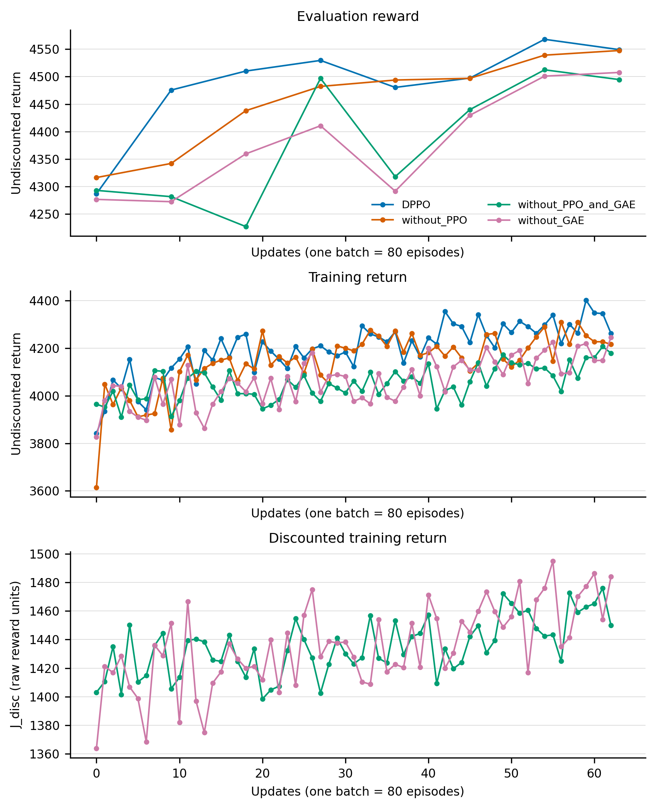

# DPPO with the Monte Carlo advantage

**Question.** Does replacing GAE with the Monte Carlo return minus the critic change performance when the PPO pieces are retained?

**Status.** Interim; the requested training seeds are not all complete and verified.

The reward comparisons fill the missing two-by-two cell. Historical logging limits the mechanistic conclusions: DPPO and without_PPO have no training J_disc, and original DPPO has neither saved clipfrac nor the switched-off fraction. No missing quantity is inferred from an unrequested rerun or from an unmatched sampler.

[Full per-seed table](ladder2x2_table.md) · [Contrasts](contrasts.md) · [Data and commands](analysis_record.json)

## Q1. GAE under reuse

DPPO minus without_GAE: last-five-evaluation difference not logged; pooled seed SD not logged; not logged; training return difference not logged; pooled seed SD not logged; not logged. Discounted-return gain cannot be compared because DPPO did not log it.

## Q2. Reuse and the interaction

Reuse under Monte Carlo: last-five-evaluation difference not logged; pooled seed SD not logged; not logged; training return difference not logged; pooled seed SD not logged; not logged.

Reuse under GAE: last-five-evaluation difference not logged; pooled seed SD not logged; not logged; training return difference not logged; pooled seed SD not logged; not logged.

The interaction is reuse under GAE minus reuse under Monte Carlo: last-five-evaluation difference not logged; pooled seed SD not logged; not logged; training return difference not logged; pooled seed SD not logged; not logged. Its J_disc counterpart is not logged. “Reuse” here changes the full PPO bundle (step reuse, ratio clip, KL stop, log-prob clamp and sampling-noise truncation); the contrast does not isolate reuse alone.

## Q3. Direction versus movement

The complete four-method question is not identifiable from the existing records: original DPPO and without_PPO did not save J_disc. Their parameter distances can be recovered from checkpoints, but distance alone cannot supply their missing vertical coordinate. The distance plots show only genuinely logged J_disc paired with the pre-rollout parameter distance, without interpolating or substituting measurements. Mean final distances are DPPO not logged; without_PPO not logged; without_PPO_and_GAE not logged; without_GAE not logged.

## Q4. How hard the PPO clip works

For without_GAE, mean clipfrac is not logged and mean switched-off fraction is not logged. Both historical DPPO quantities are not logged, preventing that direct comparison. Mean within-update PPO approximate KL is not logged for without_GAE versus not logged for DPPO; the separate true-KL column must not be compared to this PPO statistic.

## Setup and validity

Three seeds per method, 140 iterations, 126 fresh-data updates, 80 episodes per batch. without_GAE changes only the actor advantage to raw Monte Carlo return minus the pre-update critic converted to raw units; critic targets remain GAE λ=0.95. The PPO loop, noise clip, log-prob clamp, ratio clip and KL early stop retain the DPPO settings. All averages and sample SDs use independent training seeds.

Checkpoint state_0/35/70/105/139 contains 0/32/63/95/126 updates. Evaluation iteration 130 is at update 117 (9.36M environment steps). Training rows log their post-batch step counter but the plotted rollout uses the pre-update count. θ₀ for gain is each seed's own iteration-1 training J_disc, rather than the earlier shared pretrained anchor.

[Methods and commands](/soalnas/share/data/zbao7/diffusion_policy/results/stage3/dl1/methods.md) · [Gate records](/soalnas/share/data/zbao7/diffusion_policy/results/stage3/dl1/runs/gates) · [Training job file](/soalnas/share/data/zbao7/diffusion_policy/results/stage3/dl1/jobs_dl1.txt). Exact source revisions, per-run commands, completion evidence, resource sharing and filenames are retained in [analysis_record.json](analysis_record.json). No final-checkpoint sampling was requested or performed by this analysis.

## Gates, revision and allocation

| Gate | Result | Max absolute difference | Max relative difference |
| --- | --- | --- | --- |
| G1 | passed | not logged | not logged |
| G2 | passed | not logged | not logged |
| G3 | passed | 0 | 0 |
| G4 | passed | not logged | not logged |
| G5 | passed | 0 | 0 |
| G6 | passed | 0 | 0 |

Full numerical evidence: [/soalnas/share/data/zbao7/diffusion_policy/results/stage3/dl1/runs/gates/complete/gate_summary.json](/soalnas/share/data/zbao7/diffusion_policy/results/stage3/dl1/runs/gates/complete/gate_summary.json). Execution branch `stage3-dl1`, revision `9c51cd209aba253fcd611e169f4c21615e37ef95`, based on `35cb89ba46236860cc01738942d7e5d2dbad74e3`.

| Seed | Scheduler job | Node | GPU allocation | Wall seconds |
| --- | --- | --- | --- | --- |
| 0 | 17959932 | soal-10 | NVIDIA RTX A6000, GPU-3682bd5c-3f3a-46c3-f3aa-303045ccf55d, 580.82.07, 49140 MiB | 3602.6 |
| 1 | 17959933 | soal-10 | NVIDIA RTX A6000, GPU-592bcec5-b313-adef-6efd-48801e6391c0, 580.82.07, 49140 MiB | 3602.7 |
| 2 | 17959934 | soal-10 | NVIDIA RTX A6000, GPU-700af187-4695-9790-fafb-9a86d62a3011, 580.82.07, 49140 MiB | 3602.6 |

Each training process receives one allocated GPU and 40 CPUs. Allocations do not terminate or alter other jobs. Submission times and GPU identities in the saved worker manifests document resource sharing.

## Figures

[ladder2x2 curves seed0](figs/ladder2x2_curves_seed0.png) · [PDF](figs/ladder2x2_curves_seed0.pdf)

Seed 0 of each method; filled circles are point estimates, with no uncertainty shown. The horizontal axis counts actor updates before the rollout, each consuming 80 episodes; evaluation keeps the DDPM noise except at the last denoising step, while training uses a final-step noise floor of 0.1. J_disc is the raw-reward sum discounted by 0.99 per four-environment-step decision. DPPO and without_PPO did not log J_disc, so they have no discounted-return curve; all reward curves use the original runs. No smoothing or replacement runs are used. This is an interim display; three-seed curves end at the latest update shared by all three seeds.

[ladder2x2 distance seed0](figs/ladder2x2_distance_seed0.png) · [PDF](figs/ladder2x2_distance_seed0.pdf)

Seed 0 of each method; no uncertainty shown. Each point pairs the rollout's discounted training return with the actor distance before that rollout; the same iteration's post-update distance is not used. For a checkpoint-only distance record, only an exactly matching rollout update is eligible. DPPO and without_PPO have saved checkpoints but no training J_disc, so neither can be placed on this axis. Consequently this figure cannot establish the direction-versus-movement comparison across all four methods. For three-seed curves both coordinates are averaged at matching update indices, rather than interpolating returns at matched distances.

[ladder2x2 curves 3seed](figs/ladder2x2_curves_3seed.png) · [PDF](figs/ladder2x2_curves_3seed.pdf)

Three-seed means; filled circles are point estimates, with no uncertainty shown. The horizontal axis counts actor updates before the rollout, each consuming 80 episodes; evaluation keeps the DDPM noise except at the last denoising step, while training uses a final-step noise floor of 0.1. J_disc is the raw-reward sum discounted by 0.99 per four-environment-step decision. DPPO and without_PPO did not log J_disc, so they have no discounted-return curve; all reward curves use the original runs. No smoothing or replacement runs are used. This is an interim display; three-seed curves end at the latest update shared by all three seeds.

[ladder2x2 distance 3seed](figs/ladder2x2_distance_3seed.png) · [PDF](figs/ladder2x2_distance_3seed.pdf)

Three-seed means; no uncertainty shown. Each point pairs the rollout's discounted training return with the actor distance before that rollout; the same iteration's post-update distance is not used. For a checkpoint-only distance record, only an exactly matching rollout update is eligible. DPPO and without_PPO have saved checkpoints but no training J_disc, so neither can be placed on this axis. Consequently this figure cannot establish the direction-versus-movement comparison across all four methods. For three-seed curves both coordinates are averaged at matching update indices, rather than interpolating returns at matched distances.

[without gae ppo steps](figs/without_gae_ppo_steps.png) · [PDF](figs/without_gae_ppo_steps.pdf)

Seed 0; each point averages the logged minibatch quantities within one update, normally 20 steps. A pair is switched off when its normalized, denoising-weighted advantage is positive and its ratio exceeds 1+ε, or its advantage is negative and its ratio falls below 1−ε. DPPO retained per-step approximate KL in its original console log, but neither clipfrac nor switched-off fraction was saved with W&B disabled; those two reference curves are therefore absent. Approximate KL uses PPO's clamped, coordinate-mean log-prob ratio and is distinct from the post-update true-KL diagnostic. Points only; no smoothing or uncertainty shown.

All displayed curves and the progress comparison are capped at iteration 70 for every method; native results remain unchanged. Latest train/J values refer to the last training iteration at or before that cutoff.

## Current progress

| Method | Seed | Status | Last iteration | Latest eval | Latest train | Latest J_disc |
| --- | --- | --- | --- | --- | --- | --- |
| DPPO | 0 | complete | 70 | 4549.2 | 4261.8 | not logged |
| DPPO | 1 | complete | 70 | 4706.8 | 4468.1 | not logged |
| DPPO | 2 | complete | 70 | 4628.8 | 4421.2 | not logged |
| without_PPO | 0 | complete | 70 | 4547.6 | 4215.7 | not logged |
| without_PPO | 1 | complete | 70 | 4546.4 | 4221.5 | not logged |
| without_PPO | 2 | complete | 70 | 4527.6 | 4237 | not logged |
| without_PPO_and_GAE | 0 | complete | 70 | 4494.7 | 4178.9 | 1449.8 |
| without_PPO_and_GAE | 1 | complete | 70 | 4379.2 | 4057.5 | 1427.4 |
| without_PPO_and_GAE | 2 | complete | 70 | 4443.9 | 4077.3 | 1463.4 |
| without_GAE | 0 | partial | 70 | 4507.7 | 4245.2 | 1484 |
| without_GAE | 1 | partial | 70 | 4499.2 | 4262.5 | 1493.6 |
| without_GAE | 2 | partial | 68 | 4540.5 | 4283.6 | 1507.1 |

Canonical study folder: [/soalnas/share/data/zbao7/diffusion_policy/results/stage3/dl1](/soalnas/share/data/zbao7/diffusion_policy/results/stage3/dl1).
