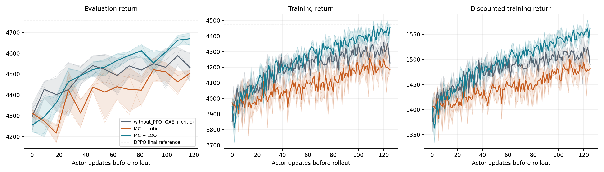

# E1C: Monte Carlo returns with a critic under AdamW

Does the E0→E1 gain come from the return estimate or the baseline?

**Status:** All three E1C runs completed. Differences below twice the pooled seed SD remain unresolved.

**Run outcomes:** 3/3 E1C seeds verified complete. Collapsed selected runs: none. Selected runs with non-finite values: none. Preserved failed attempts: none.

| Condition | Eval 9.36M | Train last10 | J_disc gain last10 | Median KL | Final distance | Final saturation |
|---|---:|---:|---:|---:|---:|---:|
| without_PPO (GAE + critic) | 4.53e+03 ± 66.8 | 4.3e+03 ± 38.8 | 141 ± 14.7 | 0.000562 ± 2.86e-05 | 0.889 ± 0.0152 | 0.119 ± 0.039 |
| MC + critic | 4.5e+03 ± 13.4 | 4.21e+03 ± 48.4 | 113 ± 14.1 | 0.000493 ± 3.61e-05 | 0.845 ± 0.00995 | 0.117 ± 0.0308 |
| MC + LOO | 4.67e+03 ± 28.1 | 4.43e+03 ± 17.1 | 184 ± 3.97 | 0.000517 ± 3.71e-05 | 0.949 ± 0.0203 | 0.138 ± 0.0296 |

Each cell is mean ± sample SD over seeds. KL first takes the median across each seed’s training updates. J_disc gain subtracts the common saved pretrained train-sampler mean 1369.024047 (240 episodes); that reference uncertainty is not a training-seed SD. Final saturation is the final training rollout’s pre-update saturation, not a new final-checkpoint evaluation.

[Figure definitions and limitations](runs/final_analysis/candidates/figs/captions.md).

**Q1 — Decomposing the gain.**
- without_PPO (GAE + critic)→MC + critic, eval_936M: difference -28.4; twice pooled SD 96.3; **unresolved**.
- without_PPO (GAE + critic)→MC + critic, train_last10: difference -95.5; twice pooled SD 87.7; **exceeds reading-rule threshold**.
- without_PPO (GAE + critic)→MC + critic, J_disc_gain_last10: difference -28.3; twice pooled SD 28.8; **unresolved**.
- MC + critic→MC + LOO, eval_936M: difference 166; twice pooled SD 44; **exceeds reading-rule threshold**.
- MC + critic→MC + LOO, train_last10: difference 222; twice pooled SD 72.6; **exceeds reading-rule threshold**.
- MC + critic→MC + LOO, J_disc_gain_last10: difference 71.6; twice pooled SD 20.7; **exceeds reading-rule threshold**.
The resolved positive J_disc gain is carried by the baseline change (E1C→E1). The other contrasts retain the qualifications above.

**Q2 — Critic quality.**
- Updates 1–10: critic/LOO energy by increasing k-bin: 15.4 ± 4.42; 8.74 ± 1.63; 5.15 ± 0.338; 3.2 ± 0.0498; 18.6 ± 1.05.
- Updates 60–70: critic/LOO energy by increasing k-bin: 3.46 ± 1.08; 1.48 ± 0.476; 0.534 ± 0.112; 2.57 ± 0.55; 52.9 ± 13.6.
- Updates 117–126: critic/LOO energy by increasing k-bin: 4.37 ± 0.977; 1.71 ± 0.379; 0.529 ± 0.0506; 3.36 ± 0.689; 68.6 ± 13.3.
- Updates 1-10: overall energy ratio 8.44 ± 1.1; mean critic/LOO energy ratio exceeds 1 in k-bins 0–49, 50–99, 100–149, 150–199, 200–249.
- Updates 60-70: overall energy ratio 5.08 ± 1.53; mean critic/LOO energy ratio exceeds 1 in k-bins 0–49, 50–99, 150–199, 200–249.
- Updates 117-126: overall energy ratio 6.52 ± 1.36; mean critic/LOO energy ratio exceeds 1 in k-bins 0–49, 50–99, 150–199, 200–249.
From the middle to final window, overall energy-ratio change is 36.6 ± 52.2% across seeds. This is a descriptive check of continued drift; a precise settling update is not identified and no new threshold is imposed.

**Q3 — First20updates.**
- MC + critic: maximum KL 0.0043 ± 0.000511; minimum J_disc 1.37e+03 ± 32.3; maximum saturation 0.0749 ± 0.00728 (mean±SD of per-seed extrema).
- MC + LOO: maximum KL 0.0044 ± 7.57e-05; minimum J_disc 1.35e+03 ± 17.4; maximum saturation 0.0781 ± 0.0051 (mean±SD of per-seed extrema).
- MC+critic minus MC+LOO, early_max_KL: -0.000103; twice pooled SD 0.000731; **unresolved**.
- MC+critic minus MC+LOO, early_min_J_disc: 18.9; twice pooled SD 51.9; **unresolved**.
- MC+critic minus MC+LOO, early_max_saturation: -0.00321; twice pooled SD 0.0126; **unresolved**.

**Q4 — Fixed-policy noise.** Latest available complete analysis round: 2300. V1/V2/V3 are frozen-policy proxies, not exact training gradients.
- P0: V1 3.26e+04 episodes [90% interval 2.98e+04–3.54e+04] (K=2300); V2 1.25e+05 episodes [90% interval 1.01e+05–1.48e+05] (K=2300); V3 3.64e+04 episodes [90% interval 3.36e+04–3.92e+04] (K=2300).
- N1: V1 1.47e+05 episodes [90% interval 1.23e+05–1.72e+05] (K=2300); V2 4.69e+05 episodes [90% interval 2.93e+05–6.45e+05] (K=2300); V3 5.17e+04 episodes [90% interval 4.47e+04–5.87e+04] (K=2300).
- N2: V1 1.55e+05 episodes [90% interval 9.44e+04–2.16e+05] (K=2300); V2 3.69e+05 episodes [90% interval 6.24e+04–6.77e+05] (K=2300); V3 3.67e+04 episodes [90% interval 3.12e+04–4.22e+04] (K=2300).
P0: smaller-to-larger B: without_PPO (GAE + critic) < MC + LOO < MC + critic. This does not match the nominal better-to-worse J_disc-gain ordering (MC + LOO > without_PPO (GAE + critic) > MC + critic). At least one training contrast is unresolved by the pooled-SD rule. Noise 90% intervals overlap for V1/V3; ranks are descriptive.
N1: smaller-to-larger B: MC + LOO < without_PPO (GAE + critic) < MC + critic. This matches the nominal better-to-worse J_disc-gain ordering (MC + LOO > without_PPO (GAE + critic) > MC + critic). At least one training contrast is unresolved by the pooled-SD rule.
N2: smaller-to-larger B: MC + LOO < without_PPO (GAE + critic) < MC + critic. This matches the nominal better-to-worse J_disc-gain ordering (MC + LOO > without_PPO (GAE + critic) > MC + critic). At least one training contrast is unresolved by the pooled-SD rule. Noise 90% intervals overlap for V1/V2; ranks are descriptive.

**Verification, execution and deviations.**
A1 raw G−cV relative error 5.88e-16 (max absolute 3.87e-12); A3 zero-critic gradient relative error 0. A2/A4/A5 reuse passed critic C2/C4/C5 after scientific-source equality checks. CPU gates took 37.2s; worker cleanup passed.
Isolated branch stage3-e1c starts from critic 0f5118492ca41abed24896176225ebcfc813b1f5; gate parent 0f5118492ca41abed24896176225ebcfc813b1f5. The ordinary source snapshot, subsequent revisions, exact commands and every attempt are retained in the linked records.
Seed 0: E1C_seed0; wall time 8.75e+03s, 62.5s/iteration including initialization and cleanup.
Seed 1: E1C_seed1; wall time 8.51e+03s, 60.8s/iteration including initialization and cleanup.
Seed 2: E1C_seed2; wall time 8.77e+03s, 62.7s/iteration including initialization and cleanup.
E1C uses three separate one-A6000/40-CPU allocations; gradient-mean admissions are capped at five while it runs. Existing workers were preserved; the critic campaign stayed paused. The E1C cap is 16 GPU-hours.

[KL and distance](runs/final_analysis/candidates/figs/updates.png) · [Saturation and direction](runs/final_analysis/candidates/figs/saturation_direction.png) · [Baseline quality](runs/final_analysis/candidates/figs/baseline_quality.png) · [Baseline bins](runs/final_analysis/candidates/figs/baseline_bins.png).
[Per-seed table](runs/final_analysis/candidates/seed_results.csv) · [Condition table](runs/final_analysis/candidates/condition_results.csv) · [Contrasts](runs/final_analysis/candidates/contrasts.csv) · [Cold-start contrasts](runs/final_analysis/candidates/cold_start_contrasts.csv) · [Noise inputs](runs/final_analysis/candidates/noise_reference.csv) · [All attempts](runs/final_analysis/candidates/attempt_inventory.csv) · [Exact commands and source provenance](runs/final_analysis/candidates/run_provenance.json).

The methods, gate evidence, commands, source revisions and resource-sharing record are linked from the study record. The approved per-chunk normalization corrects the original addendum; unweighted energies are reconstructed from saved moments. No reference runs, checkpoint evaluations or extra experiments were added. These are candidate artifacts awaiting review.

[Study record](experiment.md) · [Methods](methods.md) · [Gate results](runs/gate/gate_summary.json) · [Commands and resource records](runs/campaign.json) · [Job file](jobs_e1c.txt) · [Revisions](provenance/revisions.json).
