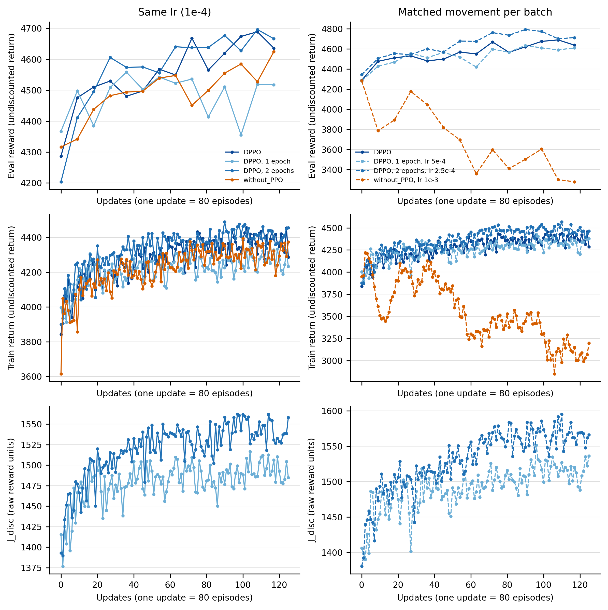
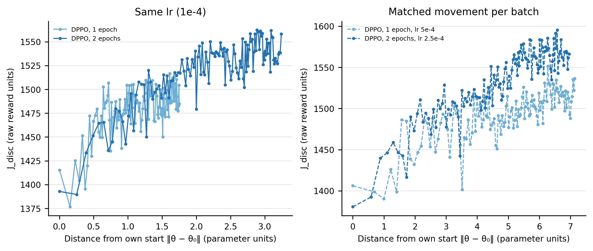
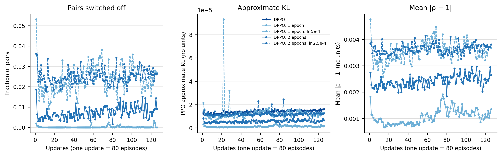

# DPPO actor epochs at fixed and matched learning rates

**Question.** Does reuse buy more than first-order movement per batch?

**Status.** The four seed-0 conditions are complete. Reward contrasts are judged against twice the original DPPO three-seed sample SD. Historical DPPO and without_PPO lack J_disc, so their discounted-gain and matched-distance comparisons remain unidentified.

[Table](epochs_table.md) · [Exact inputs and gate evidence](../analysis_record.json) · [Methods](methods.md)

## Q1. Same learning rate

DPPO, 1 epoch: eval 4517.2 (gap to DPPO -119.07; unresolved), last-ten train 4266.2 (gap -112.31; unresolved), J_disc gain 75.59. DPPO, 2 epochs: eval 4666.5 (gap to DPPO 30.227; unresolved), last-ten train 4404 (gap 25.504; unresolved), J_disc gain 144.46.

## Q2. Matched first-order movement

DPPO, 1 epoch, lr 5e-4: eval 4608.8 (gap to DPPO -27.513; unresolved), last-ten train 4325.1 (gap -53.319; unresolved), J_disc gain 106.96. DPPO, 2 epochs, lr 2.5e-4: eval 4711.7 (gap to DPPO 75.418; unresolved), last-ten train 4452.5 (gap 74.031; unresolved), J_disc gain 182.11.

Matched one-epoch minimum eval 4280.5, initial eval 4280.5. without_PPO, lr 1e-3 final eval 3279 and last-ten train 3069.8.

## Q3. Distance

The full comparison with DPPO cannot be made: its saved checkpoints provide parameter distances but no J_disc. The distance figure shows only observed new-run returns at their pre-rollout distances; it cannot establish whether DPPO buys a better direction.

## Q4. Clip

Matched one epoch: last-actor-step means are switched-off 0.023798, approx_kl 1.2643e-05 and |ratio−1| 0.0035497. DPPO last-step approx_kl is 1.4003e-05; the other two historical statistics were not logged.

## Verdict

All measured matched-one-epoch reward gaps are unresolved by the stated yardstick. The movement-only outcome remains compatible with this one seed, but equivalence is not established. final eval gap -27.513 versus threshold 2 sd = 216.59; last-five eval gap -35.313 versus threshold 2 sd = 135.84; last-ten train gap -53.319 versus threshold 2 sd = 175.43. Saved reward/J_disc observations are finite; minimum eval 4280.5 versus initial 4280.5, and minimum ten-update mean training return 4053.5. No additional collapse cutoff is imposed. Adam momentum means k·lr does not guarantee identical realized movement. Missing historical J_disc prevents a discounted-objective verdict.

## Gates and provenance

The launch requires G1–G5; final workers verify constant learning rates, actual actor/critic counts, checkpoints and clean exit. Any baseline KL early stop is recorded without changing its rule. The gate summaries, code revisions, commands, allocation identities and elapsed times are linked in the analysis record and campaign manifests. No additional seeds or reference sampling were run.

## Execution

| Method | Slurm job | Node | Wall time (s) | Median training iteration (s) |
| --- | --- | --- | --- | --- |
| DPPO, 1 epoch | 18011574 | soal-11 | 7535.7 | 58.533 |
| DPPO, 1 epoch, lr 5e-4 | 18011572 | soal-10 | 7580.9 | 59.453 |
| DPPO, 2 epochs | 18011575 | soal-11 | 7680.8 | 59.393 |
| DPPO, 2 epochs, lr 2.5e-4 | 18011573 | soal-11 | 7560.3 | 58.283 |

Each run requested one A6000, 40 CPU cores and 64 GiB. GPU identities, UTC start/end times and exact commands are in [execution_records.json](../execution_records.json); no running external job was stopped or changed.

Execution revisions: DPPO, 1 epoch: `e0db307b35debdb42762e0ef1b206def3e61ac41` (branch `stage3-epochs`); DPPO, 1 epoch, lr 5e-4: `e0db307b35debdb42762e0ef1b206def3e61ac41` (branch `stage3-epochs`); DPPO, 2 epochs: `e0db307b35debdb42762e0ef1b206def3e61ac41` (branch `stage3-epochs`); DPPO, 2 epochs, lr 2.5e-4: `e0db307b35debdb42762e0ef1b206def3e61ac41` (branch `stage3-epochs`).

[Job file](../jobs_epochs.txt) · [Launch provenance](../provenance/launch_source.json) · [Campaign and allocation record](../runs/campaign_training/campaign.json)

## Figures

Seed 0. DPPO with its actor trained for 1, 2 or 5 epochs per batch (5 = DPPO). Left: all at DPPO's lr (1e-4), so fewer epochs also means less movement per batch. Right: lr scaled so that the first-order movement per batch matches DPPO's; only the reuse of pairs differs. x = updates; each update uses 80 new episodes. without_PPO, lr 1e-3 (Stage 2) is a one-step run with about DPPO's movement per batch; it also lacks the log-prob clamp and the noise clip. Historical DPPO and without_PPO did not log J_disc; those curves are absent. No uncertainty is shown.

Seed 0. J_disc against each run's distance from its own starting parameters: runs on the same curve differ only in how far they moved. Distances correspond to the policy before the plotted rollout. DPPO and without_PPO lack J_disc and are omitted; their checkpoints alone cannot reconstruct this comparison. New runs log distances every iteration. No uncertainty is shown.

Seed 0. Clip activity at the last actor step of each update. Historical DPPO retained last-step approximate KL in its console log, but not switched-off fraction or mean ratio displacement; those reference curves are absent. Points are estimates, without uncertainty shown; dashed lines identify the matched learning rates. Diagnostics use the pre-step policy at the last applied actor step.

