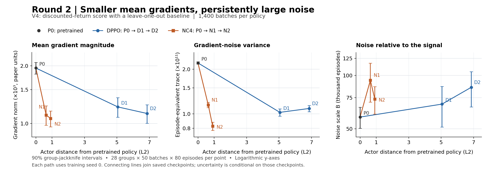

# Round 2: mean gradient and noise along DPPO and NC4

At the five frozen policies, how do the discounted-return gradient and its noise change along the two training paths?

**Round 2 resolves V4's gradient signal at every point, but an 80-episode training gradient remains strongly noise-dominated.** Gradient magnitude and noise at the later checkpoints are both smaller than at P0. The estimated cosine between the complete measurement mean and the true mean direction is only 0.75–0.81, below the 0.9 target; the comparisons remain provisional.

*V4 uses raw discounted returns with a leave-one-out baseline. The horizontal axis is actor-parameter L2 distance from the pretrained policy; logarithmic vertical axes show mean-gradient norm, episode-equivalent noise trace (80 times whole-batch variance), and noise scale B = trace / squared signal in episodes; gradient moments use paper units. Each point uses 1,400 fresh batches of 80 episodes, organized into 28 groups of 50; error bars are the saved 90% delete-one-group jackknife intervals. P0 is pretrained, D1/D2 are DPPO middle/final, and N1/N2 are NC4 middle/final; lines connect the measured checkpoints. These seed-0 checkpoints show smaller gradients and noise than P0, while B remains far above 80; the uncertainty is conditional on these checkpoints and does not establish that noise caused the training outcomes.*

The three findings supported by this snapshot are:

1. **The signal gets smaller along both paths.** V4's gradient norm is 1,947 [1,812–2,082] at P0, 1,127 [1,001–1,252] at DPPO-final, and 1,061 [960–1,161] at NC4-final. Raw discounted train-sampler return rises from 1,394 to 1,533 and 1,517 respectively. The final DPPO/NC4 gradient-norm intervals overlap; these measurements do not establish a difference between those norms.
2. **The training batch remains small relative to the noise.** V4's episode-equivalent noise scale ranges from 58,225 [50,322–66,128] to 94,026 [70,766–117,287] episodes, versus 80 episodes per training batch. The prescribed moment approximation gives a single-batch gradient cosine of only 0.029–0.037. That quantity differs from the 0.75–0.81 reliability of the mean over all 1,400 measurement batches.
3. **LOO removes a large amount of noise.** The no-baseline/LOO covariance-trace ratio is 29.37 [28.83–29.90] at P0, 77.41 [73.55–81.27] at DPPO-final, and 89.36 [83.62–95.10] at NC4-final. V4 and V5 target the same mean gradient, but V5's directly estimated squared-signal interval still includes zero at all five points. V5's noise-scale estimates therefore remain plug-in lower bounds.

All intervals above are 90% group-jackknife intervals. The signal norm uses the noise-corrected squared-gradient estimate; the episode-equivalent trace is the prescribed 80× batch trace for the coupled LOO estimator. Both paths use training seed 0, and all measurements use the same stochastic, untruncated train sampler. These results concern the finite-horizon discounted objective at selected checkpoints, with sampling uncertainty rather than variation across training seeds.

The [estimate table](round2_estimates.csv) includes squared norms, traces, returns, direction reliability, forecasts and intervals; its [column definitions](round2_estimates.caption.md) distinguish measurement-mean and training-batch quantities. [PDF plot](round2_signal_noise.pdf) · [standalone figure caption](round2_signal_noise.caption.md) · [existing detailed Round 2 analysis](../../round_1400/candidates/REPORT.md) · [methods](../../../../methods.md) · [rendering record](../manifest.json).

These are candidates for review. Collection continues under the approved stopping rule; the critic study remains paused. Curation awaits the user's decision.
