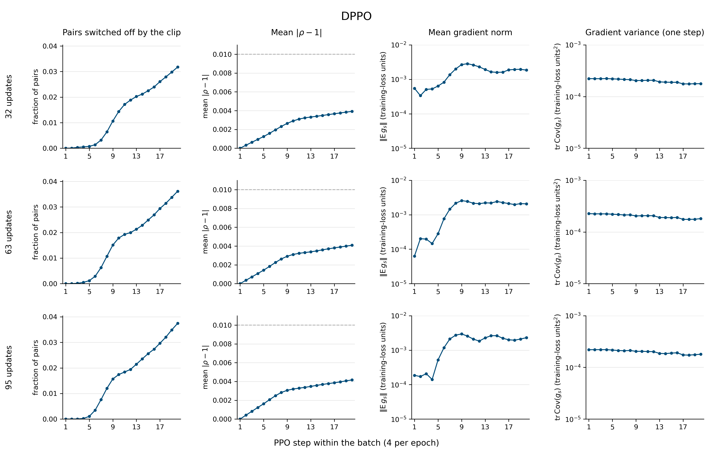
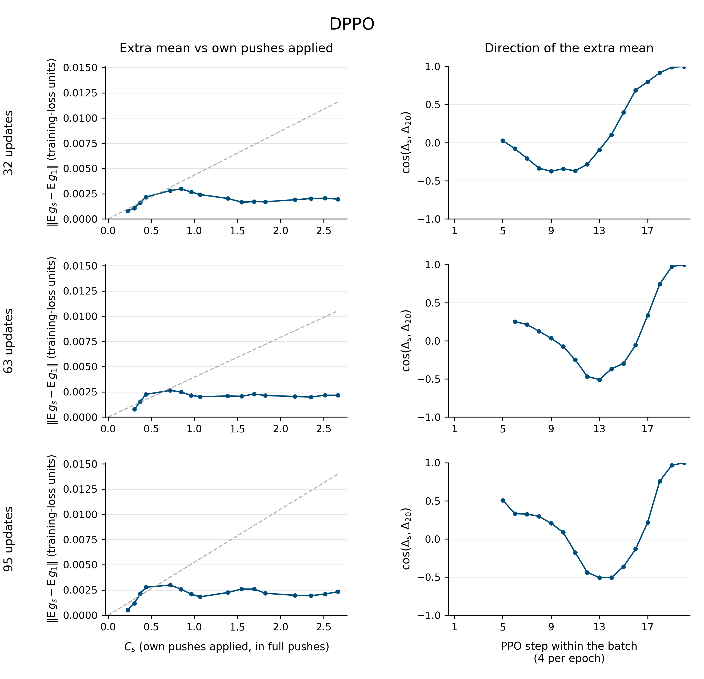

# DPPO: does clipping explain the plateau in the mean gradient?

The timing is compatible with clipping limiting growth, but the **fixed-direction cap hypothesis is contradicted at all three checkpoints**. The extra mean rotates substantially, becoming significantly opposed to its final direction. This analysis tests timing and shape, not causation: it does not measure the gradient removed by clipping.

All gates passed, and both figures and the full table are complete. With explicit approval, the direction figure uses a cosine axis of −1 to 1: the originally requested zero lower limit would hide resolved negative values. No estimates were altered.

## Q1. When does the clip engage?

The fraction of pairs switched off is nearly zero in epoch 1 and rises during epoch 2. At step 9 it reaches only 34%, 42% and 42% of its eventual maximum; half-maximum occurs later, at steps 11–12.

| DPPO updates | Step 1 | Step 4 | Step 8 | Step 9 | Step 12 | Step 20 | Half-maximum step |
|---:|---:|---:|---:|---:|---:|---:|---:|
| 32 | 0% | 0.053% | 0.643% | 1.065% | 1.885% | 3.176% | 11 |
| 63 | 0% | 0.049% | 1.073% | 1.512% | 1.998% | 3.615% | 11 |
| 95 | 0% | 0.023% | 1.204% | 1.570% | 1.943% | 3.744% | 12 |

[PDF](figs/dppo_clip_timing_grid.pdf) · [Full caption](figs/dppo_clip_timing_grid.caption.md) · [Per-step and summary table](clip_timing_table.md) · [CSV](clip_timing_table.csv)

## Q2–Q3. Growth and direction of the extra mean

Let Δ_s = E g_s − E g_1. The ratio q_s compares its norm with the line fitted through the origin against the model's own-push variable C_s, using steps 5–8. All intervals below are 90%.

| DPPO updates | First q < 0.8, s ≥ 9 | q at steps 9 / 12 / 16 / 20 | q_20 interval | Minimum cos(Δ_s, Δ_20), s ≥ 6 |
|---:|---:|---|---|---|
| 32 | 11 | 0.898 / 0.521 / 0.214 / 0.169 | [0.149, 0.189] | −0.374 [−0.581, −0.167], step 9 |
| 63 | 10 | 0.929 / 0.479 / 0.297 / 0.206 | [0.175, 0.236] | −0.508 [−0.611, −0.405], step 13 |
| 95 | 9 | 0.791 / 0.325 / 0.227 / 0.166 | [0.156, 0.176] | −0.506 [−0.551, −0.461], step 13 |

The shortfall follows the initial rise in clipping. However, the calibration segment is already curved: q_5–8 is 0.81/0.81/0.99/1.15, 0.40/0.65/1.04/1.31 and 0.43/0.74/1.09/1.21 respectively. Fitting only steps 5–6 moves the departure to steps 11, 13 and 11, and q_20 to 0.208, 0.367 and 0.264. The early linear model is therefore imperfect, especially at 63 and 95 updates.

The fixed-direction prediction fails: step-6 cosines are −0.078, 0.253 and 0.332, far below 0.8, followed by the negative alignments above. All Δ_2–Δ_4 norms are unresolved. Relative to Δ_5, their point norms are 0.47/0.49/0.88 at 32 updates, 0.27/undefined/undefined at 63, and 0.15/0.55/undefined at 95. Δ_5 is itself unresolved at 63 updates. These data cannot establish negligible non-reuse effects in epoch 1.

[PDF](figs/dppo_reuse_mean_shape_grid.pdf) · [Full caption and omitted unresolved points](figs/dppo_reuse_mean_shape_grid.caption.md)

## Q4. Variance

The final covariance trace relative to step 1 is **0.799 [0.794, 0.803]**, **0.800 [0.791, 0.810]** and **0.818 [0.810, 0.826]** at 32, 63 and 95 updates. The reductions are 20.1%, 20.0% and 18.2%, rather than approximately 25%. The broad decline accompanies increasing clipping, but is not monotonic: the ratios rise from step 9 to step 12 at 32 and 63 updates.

The premise of a flat late mean also needs qualification: mean norms at step 20 are 31%, 19% and 22% below step 9. The 32-update mean peaks at step 10 and then declines substantially.

## Q5. Alignment with the on-policy mean

All three E g_1 means are unresolved, so cos(E g_s, E g_1) is not reported. The component along Δ_20 is also consistent with zero:

| DPPO updates | Component of E g_1 along Δ_20 | Upper endpoint for ‖E g_1‖ |
|---:|---|---:|
| 32 | −1.75×10⁻⁴ [−4.19×10⁻⁴, 6.91×10⁻⁵] | 8.36×10⁻⁴ |
| 63 | −9.59×10⁻⁵ [−3.07×10⁻⁴, 1.16×10⁻⁴] | 3.34×10⁻⁴ |
| 95 | −2.66×10⁻⁵ [−1.21×10⁻⁴, 6.79×10⁻⁵] | 2.82×10⁻⁴ |

## Verdicts

**32 updates: against the simple fixed-direction cap.** Clip engagement and growth shortfall coincide, but significant rotation, an imperfect early fit and the late decline conflict with its defining shape. This is a timing test, not a causal intervention.

**63 updates: against the proposed mechanism.** Timing alone is compatible, but early curvature, fit-sensitive departure and strong rotation favor a more complex explanation. These observations cannot separate clipping from other effects of reuse and AdamW.

**95 updates: against the fixed-direction mechanism.** Clipping rises before the shortfall, but the negative alignment contradicts a single drift direction being capped. The q_9 interval [0.763, 0.820] also crosses the 0.8 threshold; the precise departure is uncertain.

## Setup, checks and provenance

Each checkpoint uses the existing 500 batches, grouped into ten independent jobs of 50, with all 20 steps retained. Primary norms and variances come unchanged from the saved per-gradient table. Extra means use float64 between-group products; joint delete-one-group jackknife intervals use t₉. Signed squared norms remain in the table. Undefined transforms or ratios are marked N/A. Degenerate intervals for threshold steps mean all ten deletions agreed, not that population timing is certain.

G1 found all inputs, with no fallback. G2 found step-1 switched-off fraction and mean |ρ−1| exactly zero. G3 found interval agreement at all 60 steps between the between-group mean norm and the saved all-batch estimator. G4 reproduced every supplied C_s to three decimals. G5's preservation check found all 2,186 pre-existing files unchanged; its final record is linked from the study record. No jobs, rollouts, gradients or GPUs were used.

Input groups are `../runs/C35_j00..09`, `C70_j00..09` and `C105_j00..09`, using `batches.csv`, `meta.json` and `sums_step01.npy`–`sums_step20.npy`. The reference is [noise_actual_table.csv](../figs/noise_actual_table.csv). Measurement revision: `838189eac4794ac921217c50e133534ce95dc6ba`; analysis branch: `analysis-dppo-clip-timing`; numerical implementation: `c146b06cf034f6939637aac2f2c0ea5ebf6777de`. Final plotting revision: `97b3ceb10529404d48df91dcdf1eec1e5946bcac`. [Complete input inventory](runs/analysis_20261019/candidates/input_inventory.json), [gates](runs/analysis_20261019/candidates/gates.json), [methods](methods.md), and [source revisions](provenance/source.json) provide reproducibility details.

The only scientific-display departure is the approved cosine axis [−1, 1]. The initial render refused the conflict before saving files. A separate canvas check also caught unused, off-axis Matplotlib tick labels; correcting that check did not alter data or plotting limits. All requested statistics and sensitivity calculations are retained. Artifacts remain uncurated; selection is a separate decision.
