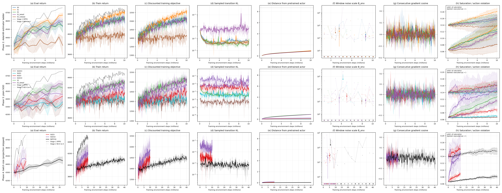
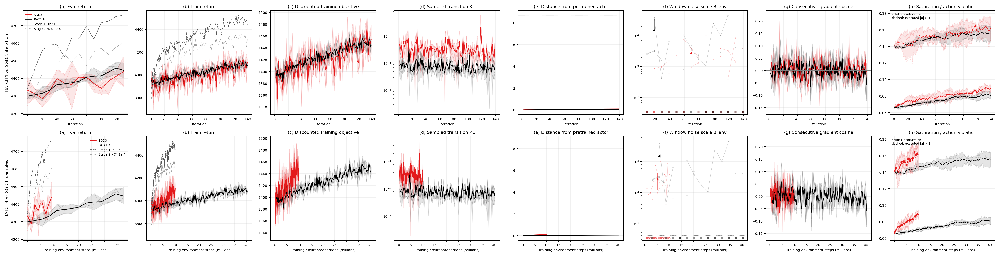

# Stage 3: Girsanov-score estimator and projected SGD

**Question.** How do the estimator, optimizer and projection affect gradient noise, discounted return and stability when moving from NC4 to the prescribed discretized score algorithm?

**Answer.** E1 improved the final scheduled eval return to 4670 ± 28 (sample SD across three seeds), compared with 4532 ± 67 for E0 and 4542 ± 81 for E2; the E1→E2 change lowered both discounted and undiscounted training return. All tested SGD rates avoided the prescribed collapse criterion, but SGD1 improved the final train-sampler discounted objective less than E2 (ΔJ_disc 40 ± 22 versus 160 ± 5). Projection was skipped by the prescribed distance rule; Phase-1 uncertainty remains inconclusive.

**Status.** 30 completed training runs, 0 failed runs, 0 observed collapse flags; prospective skips remain explicit below. All selected runs are terminal; completed/failed/skipped states are preserved.

The interpretation is limited by three training seeds, batch-coupled noise estimates and initial Gym states that are not paired by the existing seed wrapper. No additional significance tests, rescue changes or automatic retries were used.

**Phase-1 uncertainty is unreliable.** The saved raw percentile bootstrap intervals for signal norm² are strongly upward shifted. CI-based positivity/resolution claims, derived confidence intervals and noise-scale lower bounds must not be used. Signed point moments and saved point-derived ratios/cosines below are provisional; no replacement intervals were computed. Training curves and across-seed sample SDs are unaffected. [Read-only statistical audit](../../noise_ci_review.json).


**Review.** The final numerical audit passed 2,118 checks with zero differences. The figures now exclude evaluation rows from training action-range curves and preserve undefined noise-window gaps; original automatic outputs remain preserved. [Review record](../review_record.json), [numeric checks](../numeric_review.json), [plot review](../plot_review.json).

## Verification gate

Gate status: **passed**. Full machine-readable evidence: [gate_summary.json](../../gate/gate_summary.json).

| Default replay | Pass | Max absolute difference | Max relative difference | Actor steps | Critic steps |
| --- | --- | --- | --- | --- | --- |
| default_cpu | True | 0 | 0 | 20 | 20 |
| default_cuda0 | True | 0 | 0 | 20 | 20 |
| nc4_cpu | True | 0 | 0 | 1 | 20 |
| nc4_cuda0 | True | 0 | 0 | 1 | 20 |

Feature checks on **cpu**:

| Check | Evidence |
| --- | --- |
| B2a | `{"comparisons": [{"case": "random_boundaries", "max_abs": 2.6645352591003757e-15, "relative_l2": 1.766861251770297e-16}, {"case": "live_batch", "max_abs": 2.5011104298755527e-12, "relative_l2": 4.136830657269485e-16}], "passed": true}` |
| B2b | `{"episode_ends": 80, "matches": true, "max_abs": 0.0, "recursion": "Exact Stage2 source AST; lambda=1, values=0, raw rewards, reward_scale_const=1", "relative_l2": 0.0, "report_only": true, "terminated_at_ends": 80, "truncated_at_ends": 80}` |
| B3 | `{"episodes": 80, "max_abs": 6.821210263296962e-13, "max_abs_advantage_sum_per_k": 8.753886504564434e-11, "passed": true, "relative_l2": 1.0245315865601568e-16, "sum_roundoff_bound": 2.0341970659186464e-09}` |
| B4 | `{"discount_max_abs": 0.0, "episode_start_discount": 1.0, "index_max_abs": 0, "last_decision_discount": 0.08187728905270836, "passed": true, "production_e2_coefficients_bitwise_equal": true}` |
| B8 | `{"inside_bitwise": true, "one_minus_cosine": 0.0, "outside_relative_radius_error": 1.1102230246251565e-16, "passed": true, "production_actor": {"device": "cpu", "dtype": "torch.float32", "inside_bitwise": true, "nonzero_pretrained_center_norm": 694.2776660278384, "one_minus_cosine": 3.0336844147882402e-12, "outside_relative_radius_error": 4.002633192667915e-07, "parallelism_tolerance": 1e-06, "parameters": 568392, "radius": 8.686025494700294}}` |
| B10 | `{"dimension": 1000, "estimated_tr_sigma": 999.2179068722709, "estimated_u_sq": 3.8422526152681473, "n": 1000, "passed": true, "se_tr_sigma": 1.4728100702976508, "se_u_sq": 0.13479306177682207, "signal_error_in_se": 1.1702930599873014, "true_tr_sigma": 1000.0, "true_u_sq": 4.000000000000002, "variance_error_in_se": 0.5310210348922096}` |
| B1 | `{"max_abs": 0.0, "passed": true, "relative_l2": 0.0, "tolerance": 1e-05}` |
| B5 | `{"factor": 24, "max_abs": 1.4901161193847656e-06, "passed": true, "relative_l2": 6.877344645177401e-07, "tolerance": 1e-06}` |
| B6 | `{"cosine": 0.999567714181953, "expected_above_0999": true, "report_only": true}` |
| B7 | `{"eta": 0.0001, "lr_over_20_steps": [0.0001, 0.0001, 0.0001, 0.0001, 0.0001, 0.0001, 0.0001, 0.0001, 0.0001, 0.0001, 0.0001, 0.0001, 0.0001, 0.0001, 0.0001, 0.0001, 0.0001, 0.0001, 0.0001, 0.0001], "max_abs": 6.794650104779976e-07, "passed": true, "relative_l2": 1.042423701293165e-08}` |

Feature checks on **cuda:0**:

| Check | Evidence |
| --- | --- |
| B2a | `{"comparisons": [{"case": "random_boundaries", "max_abs": 2.6645352591003757e-15, "relative_l2": 1.766861251770297e-16}, {"case": "live_batch", "max_abs": 2.5011104298755527e-12, "relative_l2": 4.136830657269485e-16}], "passed": true}` |
| B2b | `{"episode_ends": 80, "matches": true, "max_abs": 0.0, "recursion": "Exact Stage2 source AST; lambda=1, values=0, raw rewards, reward_scale_const=1", "relative_l2": 0.0, "report_only": true, "terminated_at_ends": 80, "truncated_at_ends": 80}` |
| B3 | `{"episodes": 80, "max_abs": 6.821210263296962e-13, "max_abs_advantage_sum_per_k": 8.753886504564434e-11, "passed": true, "relative_l2": 1.0245315865601568e-16, "sum_roundoff_bound": 2.0341970659186464e-09}` |
| B4 | `{"discount_max_abs": 0.0, "episode_start_discount": 1.0, "index_max_abs": 0, "last_decision_discount": 0.08187728905270836, "passed": true, "production_e2_coefficients_bitwise_equal": true}` |
| B8 | `{"inside_bitwise": true, "one_minus_cosine": 0.0, "outside_relative_radius_error": 1.1102230246251565e-16, "passed": true, "production_actor": {"device": "cuda:0", "dtype": "torch.float32", "inside_bitwise": true, "nonzero_pretrained_center_norm": 694.2776660278302, "one_minus_cosine": 3.0619951019161817e-12, "outside_relative_radius_error": 4.002632983945986e-07, "parallelism_tolerance": 1e-06, "parameters": 568392, "radius": 8.686025494700294}}` |
| B10 | `{"dimension": 1000, "estimated_tr_sigma": 999.2179068722709, "estimated_u_sq": 3.8422526152681473, "n": 1000, "passed": true, "se_tr_sigma": 1.4728100702976508, "se_u_sq": 0.13479306177682207, "signal_error_in_se": 1.1702930599873014, "true_tr_sigma": 1000.0, "true_u_sq": 4.000000000000002, "variance_error_in_se": 0.5310210348922096}` |
| B1 | `{"max_abs": 0.0, "passed": true, "relative_l2": 0.0, "tolerance": 0.0001}` |
| B5 | `{"factor": 24, "max_abs": 5.27501106262207e-06, "passed": true, "relative_l2": 9.261727633733423e-07, "tolerance": 1e-06}` |
| B6 | `{"cosine": 0.9995677136693141, "expected_above_0999": true, "report_only": true}` |
| B7 | `{"eta": 0.0001, "lr_over_20_steps": [0.0001, 0.0001, 0.0001, 0.0001, 0.0001, 0.0001, 0.0001, 0.0001, 0.0001, 0.0001, 0.0001, 0.0001, 0.0001, 0.0001, 0.0001, 0.0001, 0.0001, 0.0001, 0.0001, 0.0001], "max_abs": 6.794643603313943e-07, "passed": true, "relative_l2": 1.0424222088701362e-08}` |

B9 diagnostics-inert gate: **True**; parameters, optimizer state, gradients and global RNG comparison details remain in the linked gate.

CPU defaults require bitwise equality; GPU tolerances are taken from the saved gate. B2b and B6 are report-only checks. A missing/failed gate does not authorize scientific launches.

## Phase 1: fixed-policy gradient noise

Each policy point uses 25 fresh batches, 40 environments per batch and two episodes per environment. Gradients are negative mean-loss gradients per 5,000-pair env rollout; sign does not affect norms or pairwise cosines. The prescribed n-based signal correction is approximate for full-batch-normalized and LOO-coupled variants.

**Phase-1 uncertainty is unreliable.** The saved raw percentile bootstrap intervals for signal norm² are strongly upward shifted. CI-based positivity/resolution claims, derived confidence intervals and noise-scale lower bounds must not be used. Signed point moments and saved point-derived ratios/cosines below are provisional; no replacement intervals were computed. Training curves and across-seed sample SDs are unaffected. [Read-only statistical audit](../../noise_ci_review.json).

The saved 90% intervals used 2,000 whole-batch resamples. They remain in the raw records for provenance but are omitted from these tables, together with the invalid confidence-based flags and bounds. This bootstrap problem also affects V5, which has no normalization or LOO coupling. B10 checked point moments, not interval coverage.

### Pretrained θ₀

Status: complete.

Original measurement and uncertainty fields (preserved): [noise_scale.json](../../../ns_theta0_seed1000/noise_scale.json).

| Variant | Signal norm² (point only) | Noise trace (point only) | B_env (point only) | B_ep (point only) | Batch SNR (point only) | Expected batch cosine (point only) |
| --- | --- | --- | --- | --- | --- | --- |
| nc4 | 1.054e-07 | 0.002175 | 2.063e+04 | 4.125e+04 | 0.001939 | 0.04399 |
| mc_critic | -6.383e-08 | 0.002176 | — | — | — | — |
| mc_loo | 1.088e-07 | 0.002354 | 2.163e+04 | 4.326e+04 | 0.001849 | 0.04296 |
| theory_loo | 0.4828 | 1.89e+04 | 3.914e+04 | 7.828e+04 | 0.001022 | 0.03195 |
| theory_nobase | 9.066 | 5.181e+05 | 5.715e+04 | 1.143e+05 | 0.0007 | 0.02645 |

Saved provisional mean-direction cosine points (not clipped; dashes retain unavailable entries and do not imply validated signal resolution):

| Variant | nc4 | mc_critic | mc_loo | theory_loo | theory_nobase |
| --- | --- | --- | --- | --- | --- |
| nc4 | 1 | — | 1.214 | 1.518 | 1.103 |
| mc_critic | — | — | — | — | — |
| mc_loo | 1.214 | — | 1 | 0.7093 | -0.4719 |
| theory_loo | 1.518 | — | 0.7093 | 1 | -0.2686 |
| theory_nobase | 1.103 | — | -0.4719 | -0.2686 | 1 |

Warm-up batches: 20; warmed-critic explained variance on the first frozen measurement batch: 0.6442. No valid Phase-1 confidence bound is reported.

### NC4 final θ checkpoint

Status: complete.

Original measurement and uncertainty fields (preserved): [noise_scale.json](../../../ns_ckpt_seed2000/noise_scale.json).

| Variant | Signal norm² (point only) | Noise trace (point only) | B_env (point only) | B_ep (point only) | Batch SNR (point only) | Expected batch cosine (point only) |
| --- | --- | --- | --- | --- | --- | --- |
| nc4 | 2.706e-07 | 0.002107 | 7785 | 1.557e+04 | 0.005138 | 0.0715 |
| mc_critic | 1.419e-07 | 0.002127 | 1.499e+04 | 2.997e+04 | 0.002669 | 0.05159 |
| mc_loo | 2.548e-08 | 0.002987 | 1.172e+05 | 2.345e+05 | 0.0003412 | 0.01847 |
| theory_loo | -0.3188 | 1.191e+04 | — | — | — | — |
| theory_nobase | 48.32 | 5.894e+05 | 1.22e+04 | 2.44e+04 | 0.003279 | 0.05717 |

Saved provisional mean-direction cosine points (not clipped; dashes retain unavailable entries and do not imply validated signal resolution):

| Variant | nc4 | mc_critic | mc_loo | theory_loo | theory_nobase |
| --- | --- | --- | --- | --- | --- |
| nc4 | 1 | 1.512 | 1.279 | — | 1.319 |
| mc_critic | 1.512 | 1 | 0.5014 | — | 1.102 |
| mc_loo | 1.279 | 0.5014 | 1 | — | -0.705 |
| theory_loo | — | — | — | — | — |
| theory_nobase | 1.319 | 1.102 | -0.705 | — | 1 |

Warm-up batches: 5; warmed-critic explained variance on the first frozen measurement batch: 0.2734. No valid Phase-1 confidence bound is reported.

## Calibration and projection anchors

KL* = **0.0005845173361**, the pooled median of 378 training diagnostics from the three Stage-2 NC4 1e-4 runs. R = **8.686025495**, 1.25 times the largest Stage-1 final actor distance. The anchor measurements were fixed before wave 0.

| Reference | Seed 0 distance | Seed 1 distance | Seed 2 distance |
| --- | --- | --- | --- |
| Stage 1 | 6.858 | 6.936 | 6.949 |
| Stage 2 NC4 1e-4 | 0.9097 | 0.8785 | 0.8952 |

η* = **0.0001210723567**; η*_theory = **4.84289427e-08**; max/min η_b = **3.395**.

| Batch | η_b | η_theory | KL(η_b) | Local exponent | Warnings |
| --- | --- | --- | --- | --- | --- |
| 0 | 9.045144103e-05 | 3.618057641e-08 | 0.0005837 | 2.013 | none |
| 1 | 0.0002442157112 | 9.768628446e-08 | 0.0005852 | 1.992 | none |
| 2 | 0.0001519397928 | 6.077591712e-08 | 0.0005859 | 1.98 | none |
| 3 | 0.0001210723567 | 4.84289427e-08 | 0.0005839 | 2.008 | none |
| 4 | 7.192369226e-05 | 2.87694769e-08 | 0.000599 | 1.786 | none |

Calibration-wide warnings: eta_b spread exceeds 3x.

## Training curves



The three rows compare the AdamW estimator ladder, the SGD sweep, and the batch-size condition; both projection conditions were skipped by the prescribed distance rule, and columns show the eight quantities named on the axes. Thin lines are individual training seeds; bold curves and bands are the mean ± sample SD (ddof=1) only where all three seeds have finite comparable observations, with no smoothing or extrapolation. Gray dashed/dotted curves are the Stage-1 DPPO and Stage-2 NC4 1e-4 means where those metrics exist; the distance guide is the fixed projection radius, and B_env=40 marks unit training-batch SNR under the approximate independent-env interpretation. B_env uses complete nonoverlapping iteration windows [0,9], [10,19], etc., each containing nine training iterations, and equals 10 times summed split-gradient squared differences divided by summed split dots; bottom-axis crosses mark nonpositive denominators, not numerical values. Undefined windows remain gaps in individual lines, means and bands; point markers and SD whiskers retain isolated defined estimates. Log axes omit exact/nonpositive observations and nonpositive lower SD bands without epsilon replacement; raw values and failure prefixes remain in the CSVs. In the final panel, solid curves show pre-update x0 saturation and dashed curves the fraction of physical executed action coordinates outside [-1,1]; both use training iterations only. BATCH4 has four times as many samples per iteration; its second figure repeats the comparison against iteration and environment samples. Shared full-batch normalization/LOO coefficients couple split estimates, so noise scales are approximate; three seeds do not establish a general ordering.

Omitted log-axis / undefined observations: `{"nonpositive_B_env_points": 0, "nonpositive_kl_points": 0, "nonpositive_lower_sd_bands": 60, "undefined_noise_windows": 227}`. Values remain in the raw tables.



The same eight quantities are shown against iteration in the first row and environment samples in the second. Aggregation and uncertainty follow the preceding caption; BATCH4 collects 320 episodes instead of 80 at the same SGD3 step size. The budgets therefore differ by four in samples at equal iteration.

## Results tables

Each cell lists seed 0 / seed 1 / seed 2, followed by mean ± sample SD (ddof=1). Means require all three comparable seed values; missing failures are never replaced by survivor-only means. Last-10 summaries use the final ten training iterations of a completed 140-iteration run. Final evaluation is itr 130 (9.36M env steps; BATCH4 37.44M); state_139 contains the final post-update actor. The complete machine-readable tables are [per seed](seed_results.csv), [per condition](condition_results.csv), [all iteration values](all_runs_long.csv) and [noise windows](noise_windows.csv).

| Condition | Eval itr 0 | Eval itr 130 | Train last 10 | Discounted train last 10 |
| --- | --- | --- | --- | --- |
| E0 | 4320 / 4338 / 4223; 4294 ± 61.87 | 4603 / 4523 / 4471; 4532 ± 66.8 | 4286 / 4347 / 4275; 4303 ± 38.76 | 1503 / 1527 / 1500; 1510 ± 14.72 |
| E1 | 4267 / 4274 / 4221; 4254 ± 29.05 | 4683 / 4688 / 4637; 4670 ± 28.09 | 4422 / 4417 / 4449; 4429 ± 17.05 | 1553 / 1549 / 1557; 1553 ± 3.967 |
| E2 | 4327 / 4361 / 4303; 4330 ± 29.45 | 4539 / 4625 / 4462; 4542 ± 81.45 | 4296 / 4323 / 4300; 4307 ± 14.38 | 1507 / 1518 / 1506; 1510 ± 6.662 |
| E2_beta0 | 4309 / 4339 / 4312; 4320 ± 16.65 | 4596 / 4542 / 4625; 4588 ± 42.19 | 4295 / 4287 / 4322; 4301 ± 18.13 | 1509 / 1505 / 1520; 1511 ± 8.15 |
| E2_nobase | 4189 / 4276 / 4291; 4252 ± 54.97 | 4392 / 4342 / 4184; 4306 ± 108.7 | 4089 / 3957 / 3914; 3987 ± 91.28 | 1444 / 1404 / 1389; 1412 ± 28.83 |
| SGD03 | 4392 / 4274 / 4276; 4314 ± 67.33 | 4350 / 4344 / 4323; 4339 ± 14.17 | 3931 / 3968 / 3921; 3940 ± 24.33 | 1396 / 1407 / 1393; 1399 ± 7.714 |
| SGD1 | 4249 / 4295 / 4386; 4310 ± 70.01 | 4348 / 4307 / 4437; 4364 ± 66.63 | 3993 / 3982 / 3968; 3981 ± 12.42 | 1417 / 1410 / 1410; 1413 ± 3.951 |
| SGD3 | 4383 / 4369 / 4247; 4333 ± 75.07 | 4527 / 4359 / 4428; 4438 ± 84.22 | 4101 / 4050 / 4126; 4092 ± 38.68 | 1457 / 1434 / 1460; 1450 ± 14.01 |
| SGD10 | 4255 / 4267 / 4417; 4313 ± 89.99 | 4533 / 4505 / 4337; 4458 ± 105.9 | 4262 / 4271 / 4074; 4202 ± 111.1 | 1500 / 1510 / 1429; 1480 ± 44.25 |
| PROJ3 | skipped (distance rule) | skipped (distance rule) | skipped (distance rule) | skipped (distance rule) |
| PROJ10 | skipped (distance rule) | skipped (distance rule) | skipped (distance rule) | skipped (distance rule) |
| BATCH4 | 4317 / 4293 / 4286; 4299 ± 16.55 | 4418 / 4424 / 4495; 4446 ± 42.6 | 4081 / 4100 / 4090; 4090 ± 9.527 | 1443 / 1452 / 1448; 1448 ± 4.714 |

| Condition | Final train-sampler return | Final eval-sampler return | Final train J_disc | Final eval J_disc | Δ train J_disc | Δ eval J_disc |
| --- | --- | --- | --- | --- | --- | --- |
| E0 | 4417 / 4380 / 4275; 4358 ± 73.68 | 4615 / 4586 / 4603; 4601 ± 14.22 | 1546 / 1528 / 1504; 1526 ± 20.92 | 1609 / 1608 / 1605; 1607 ± 1.886 | 176.8 / 159.4 / 135.2; 157.1 ± 20.92 | 112.5 / 111.4 / 108.8; 110.9 ± 1.886 |
| E1 | 4361 / 4411 / 4488; 4420 ± 63.99 | 4714 / 4715 / 4687; 4705 ± 15.94 | 1534 / 1546 / 1574; 1551 ± 20.27 | 1640 / 1649 / 1639; 1643 ± 5.459 | 165 / 176.7 / 204.5; 182.1 ± 20.27 | 143.6 / 152.8 / 143.2; 146.5 ± 5.459 |
| E2 | 4368 / 4366 / 4335; 4357 ± 18.38 | 4578 / 4574 / 4534; 4562 ± 24.13 | 1532 / 1532 / 1524; 1529 ± 4.68 | 1608 / 1592 / 1584; 1595 ± 12.56 | 163.1 / 163.2 / 155.1; 160.5 ± 4.68 | 112.3 / 95.66 / 87.75; 98.58 ± 12.56 |
| E2_beta0 | 4269 / 4380 / 4369; 4339 ± 60.84 | 4639 / 4603 / 4647; 4630 ± 23.66 | 1495 / 1532 / 1528; 1518 ± 20.39 | 1616 / 1612 / 1619; 1616 ± 3.29 | 125.9 / 163.3 / 158.7; 149.3 ± 20.39 | 119.8 / 116.3 / 122.8; 119.6 ± 3.29 |
| E2_nobase | 4108 / 4051 / 3824; 3995 ± 150.2 | 4488 / 4323 / 4213; 4341 ± 138.1 | 1447 / 1422 / 1333; 1401 ± 59.58 | 1580 / 1531 / 1487; 1533 ± 46.69 | 77.63 / 53.37 / -35.54; 31.82 ± 59.58 | 84.02 / 35.19 / -9.318; 36.63 ± 46.69 |
| SGD03 | 3906 / 3956 / 3995; 3952 ± 44.54 | 4323 / 4281 / 4312; 4306 ± 21.73 | 1396 / 1402 / 1434; 1411 ± 20.6 | 1529 / 1517 / 1521; 1522 ± 6.254 | 26.98 / 32.93 / 65.26; 41.72 ± 20.6 | 33.26 / 21.08 / 24.71; 26.35 ± 6.254 |
| SGD1 | 3902 / 3991 / 4045; 3979 ± 72.39 | 4415 / 4347 / 4274; 4345 ± 70.69 | 1388 / 1408 / 1431; 1409 ± 21.77 | 1545 / 1541 / 1523; 1536 ± 11.94 | 18.93 / 38.9 / 62.43; 40.09 ± 21.77 | 49.08 / 45.08 / 26.69; 40.28 ± 11.94 |
| SGD3 | 4107 / 4082 / 4108; 4099 ± 14.69 | 4404 / 4361 / 4443; 4403 ± 41.26 | 1460 / 1435 / 1466; 1454 ± 16.53 | 1563 / 1535 / 1568; 1555 ± 17.47 | 91.33 / 65.75 / 96.68; 84.59 ± 16.53 | 66.54 / 39.1 / 71.55; 59.06 ± 17.47 |
| SGD10 | 4275 / 4307 / 4085; 4222 ± 120 | 4519 / 4581 / 4388; 4496 ± 98.65 | 1503 / 1517 / 1426; 1482 ± 49.22 | 1599 / 1612 / 1533; 1581 ± 42.26 | 134.4 / 148.1 / 56.84; 113.1 ± 49.22 | 102.9 / 115.6 / 36.91; 85.16 ± 42.26 |
| PROJ3 | skipped (distance rule) | skipped (distance rule) | skipped (distance rule) | skipped (distance rule) | skipped (distance rule) | skipped (distance rule) |
| PROJ10 | skipped (distance rule) | skipped (distance rule) | skipped (distance rule) | skipped (distance rule) | skipped (distance rule) | skipped (distance rule) |
| BATCH4 | 4008 / 3884 / 4105; 3999 ± 110.9 | 4473 / 4460 / 4377; 4437 ± 52.12 | 1435 / 1392 / 1465; 1431 ± 37.1 | 1584 / 1558 / 1542; 1561 ± 21.26 | 66.23 / 22.5 / 96.28; 61.67 ± 37.1 | 88.25 / 61.66 / 46.23; 65.38 ± 21.26 |

| Condition | Median KL | Final θ distance | Median B_env | Zero-update fraction | Projection fraction |
| --- | --- | --- | --- | --- | --- |
| E0 | 0.0005294 / 0.0005717 / 0.0005838; 0.0005616 ± 2.857e-05 | 0.9053 / 0.8849 / 0.8755; 0.8886 ± 0.0152 | 1535 / 2061 / 2049; 1882 ± 300.3 | 0 / 0 / 0; 0 ± 0 | 0 / 0 / 0; 0 ± 0 |
| E1 | 0.0004748 / 0.0005306 / 0.0005451; 0.0005168 ± 3.711e-05 | 0.9266 / 0.9528 / 0.9667; 0.9487 ± 0.02034 | 1682 / 1660 / 1780; 1708 ± 64.09 | 0 / 0 / 0; 0 ± 0 | 0 / 0 / 0; 0 ± 0 |
| E2 | 0.0003197 / 0.0004516 / 0.0003586; 0.0003766 ± 6.775e-05 | 0.8629 / 0.8851 / 0.881; 0.8763 ± 0.01182 | 2750 / 3020 / 1454; 2408 ± 837.2 | 0 / 0 / 0; 0 ± 0 | 0 / 0 / 0; 0 ± 0 |
| E2_beta0 | 0.004988 / 0.006105 / 0.00557; 0.005554 ± 0.0005588 | 0.8317 / 0.8864 / 0.8504; 0.8562 ± 0.02777 | 1599 / 1285 / 3138; 2007 ± 991.8 | 0 / 0 / 0; 0 ± 0 | 0 / 0 / 0; 0 ± 0 |
| E2_nobase | 0.0003655 / 0.0004113 / 0.0004817; 0.0004195 ± 5.852e-05 | 0.8615 / 0.8974 / 0.8894; 0.8828 ± 0.01883 | 2306 / 1279 / 1159; 1581 ± 630.2 | 0 / 0 / 0; 0 ± 0 | 0 / 0 / 0; 0 ± 0 |
| SGD03 | 3.594e-05 / 4.216e-05 / 4.27e-05; 4.027e-05 ± 3.759e-06 | 0.01047 / 0.01011 / 0.009728; 0.0101 ± 0.0003723 | 1723 / 2041 / 2126; 1964 ± 212.2 | 0 / 0 / 0; 0 ± 0 | 0 / 0 / 0; 0 ± 0 |
| SGD1 | 0.0003302 / 0.000362 / 0.0003315; 0.0003412 ± 1.799e-05 | 0.02984 / 0.02966 / 0.03016; 0.02989 ± 0.0002559 | 1577 / 3371 / 1567; 2172 ± 1039 | 0 / 0 / 0; 0 ± 0 | 0 / 0 / 0; 0 ± 0 |
| SGD3 | 0.002439 / 0.003089 / 0.0023; 0.002609 ± 0.0004209 | 0.08804 / 0.08582 / 0.0888; 0.08755 ± 0.001547 | 2982 / 1164 / 2437; 2194 ± 932.9 | 0 / 0 / 0; 0 ± 0 | 0 / 0 / 0; 0 ± 0 |
| SGD10 | 0.02612 / 0.01768 / 0.02039; 0.0214 ± 0.004312 | 0.2521 / 0.2571 / 0.216; 0.2417 ± 0.02242 | 1742 / 1693 / 3991; 2475 ± 1313 | 0 / 0 / 0; 0 ± 0 | 0 / 0 / 0; 0 ± 0 |
| PROJ3 | skipped (distance rule) | skipped (distance rule) | skipped (distance rule) | skipped (distance rule) | skipped (distance rule) |
| PROJ10 | skipped (distance rule) | skipped (distance rule) | skipped (distance rule) | skipped (distance rule) | skipped (distance rule) |
| BATCH4 | 0.0006125 / 0.0006339 / 0.0006033; 0.0006166 ± 1.57e-05 | 0.0488 / 0.0506 / 0.04959; 0.04966 ± 0.0009064 | 4473 / 3804 / 2380; 3552 ± 1069 | 0 / 0 / 0; 0 ± 0 | 0 / 0 / 0; 0 ± 0 |

| Condition | Mean x0 saturation | Last-step x0 saturation | Action outside range | Seconds / training itr |
| --- | --- | --- | --- | --- |
| E0 | 0.1032 / 0.115 / 0.07028; 0.09616 ± 0.02318 | 0.03789 / 0.04775 / 0.02086; 0.0355 ± 0.01361 | 0.1504 / 0.1578 / 0.1379; 0.1487 ± 0.01008 | 65.1 / 67.31 / 70.39; 67.6 ± 2.659 |
| E1 | 0.0902 / 0.09483 / 0.1156; 0.1002 ± 0.01353 | 0.03985 / 0.05832 / 0.06591; 0.05469 ± 0.0134 | 0.1551 / 0.162 / 0.165; 0.1607 ± 0.005086 | 67.64 / 68.12 / 65.71; 67.16 ± 1.274 |
| E2 | 0.1084 / 0.1027 / 0.08087; 0.0973 ± 0.01451 | 0.05256 / 0.03377 / 0.02616; 0.0375 ± 0.01359 | 0.1594 / 0.1499 / 0.143; 0.1508 ± 0.008226 | 55.12 / 55.41 / 56.16; 55.56 ± 0.54 |
| E2_beta0 | 0.08447 / 0.08817 / 0.08644; 0.08636 ± 0.001852 | 0.03204 / 0.03651 / 0.03553; 0.03469 ± 0.002349 | 0.1489 / 0.1462 / 0.1524; 0.1492 ± 0.003079 | 57.38 / 56.59 / 57.18; 57.05 ± 0.4094 |
| E2_nobase | 0.08631 / 0.06868 / 0.05507; 0.07002 ± 0.01567 | 0.03271 / 0.03399 / 0.01231; 0.02634 ± 0.01217 | 0.1474 / 0.1408 / 0.1212; 0.1365 ± 0.01359 | 56.78 / 57.55 / 54.99; 56.44 ± 1.317 |
| SGD03 | 0.06663 / 0.06642 / 0.06604; 0.06637 ± 0.0003007 | 0.02261 / 0.02546 / 0.02378; 0.02395 ± 0.001435 | 0.1402 / 0.1425 / 0.1405; 0.1411 ± 0.001228 | 54.91 / 56.11 / 57.05; 56.02 ± 1.069 |
| SGD1 | 0.06632 / 0.06775 / 0.06974; 0.06794 ± 0.00172 | 0.03015 / 0.01453 / 0.02722; 0.02397 ± 0.008306 | 0.144 / 0.1329 / 0.1442; 0.1404 ± 0.006479 | 57.04 / 56.88 / 57.1; 57.01 ± 0.1089 |
| SGD3 | 0.08009 / 0.08125 / 0.07707; 0.07947 ± 0.002159 | 0.06546 / 0.02539 / 0.0483; 0.04638 ± 0.0201 | 0.1605 / 0.1425 / 0.1549; 0.1526 ± 0.009215 | 54.49 / 56.16 / 58.14; 56.27 ± 1.827 |
| SGD10 | 0.114 / 0.1316 / 0.1196; 0.1218 ± 0.00901 | 0.03788 / 0.1389 / 0.00922; 0.06201 ± 0.06814 | 0.1465 / 0.1783 / 0.1028; 0.1425 ± 0.03788 | 55.57 / 56.71 / 57.28; 56.52 ± 0.8692 |
| PROJ3 | skipped (distance rule) | skipped (distance rule) | skipped (distance rule) | skipped (distance rule) |
| PROJ10 | skipped (distance rule) | skipped (distance rule) | skipped (distance rule) | skipped (distance rule) |
| BATCH4 | 0.07305 / 0.07427 / 0.07642; 0.07458 ± 0.001706 | 0.02776 / 0.03998 / 0.03941; 0.03572 ± 0.0069 | 0.146 / 0.1521 / 0.1513; 0.1498 ± 0.003338 | 223.6 / 220.4 / 224.7; 222.9 ± 2.212 |

| Condition | Run states (0/1/2) | Observed collapse flags (0/1/2) |
| --- | --- | --- |
| E0 | complete / complete / complete | False / False / False |
| E1 | complete / complete / complete | False / False / False |
| E2 | complete / complete / complete | False / False / False |
| E2_beta0 | complete / complete / complete | False / False / False |
| E2_nobase | complete / complete / complete | False / False / False |
| SGD03 | complete / complete / complete | False / False / False |
| SGD1 | complete / complete / complete | False / False / False |
| SGD3 | complete / complete / complete | False / False / False |
| SGD10 | complete / complete / complete | False / False / False |
| PROJ3 | skipped / skipped / skipped | not run |
| PROJ10 | skipped / skipped / skipped | not run |
| BATCH4 | complete / complete / complete | False / False / False |

Collapse means an observed eval return below half that run's itr-0 value or a numerical nonfinite failure. Null diagnostics caused by unavailable previous gradients or nonpositive split dots are undefined measurements, not numerical failures. Failed-run finite prefixes remain in plots/long tables and their status remains explicit; final summaries are unavailable when the required run endpoint was not reached.

### Final pretrained evaluation

| Sampler | Undiscounted mean ± episode s.e. | J_disc mean ± episode s.e. | Episodes | x0 saturation |
| --- | --- | --- | --- | --- |
| train | 3856 ± 48.56 | 1369 ± 15.12 | 240 | 0.06563 |
| eval | 4234 ± 40.92 | 1496 ± 12.48 | 240 | 0.06743 |

Final checkpoints each contribute 80 episodes per sampler; θ₀ contributes three rollouts (240 episodes per sampler). ΔJ_disc subtracts the corresponding pooled θ₀ mean; the reported across-seed SD does not incorporate θ₀'s episode-level estimation uncertainty.

Seed initialized once; each repeat collects train then eval, with continuous policy RNG across repeats. Pretrained repeat 0 has the same policy-RNG prefix as each one-repeat checkpoint job. DDPM deterministic=True still adds noise at t>0, and zero noise at t=0. Seed 5000 aligns policy RNG streams across checkpoints, but the existing wrapper does not seed Gym's underlying np_random generator, so initial environment states are not fully paired; environment seeding remains unchanged.

## Answers to Q1–Q8

**Q1–Q3 uncertainty limit.** Phase-1 numbers are provisional point estimates only: the saved percentile CIs cannot establish signal positivity, noise dominance, an estimator ranking, or a change between policies. No confidence lower bounds are used. See the [statistical audit](../../noise_ci_review.json); the separate training-seed sample-SD comparisons remain available.

### Q1. Noise at m=80 episodes

| Variant | B_ep (provisional point) | Expected batch-gradient cosine (provisional point) |
| --- | --- | --- |
| nc4 | 4.125e+04 | 0.04399 |
| mc_critic | — | — |
| mc_loo | 4.326e+04 | 0.04296 |
| theory_loo | 7.828e+04 | 0.03195 |
| theory_nobase | 1.143e+05 | 0.02645 |

V5's provisional point estimate gives B_ep=1.143e+05 and expected batch cosine=0.02645. This suggests noise-dominated gradients when B_ep exceeds 80, but the unavailable valid uncertainty prevents a confidence-based conclusion. No lower bound is reported.

### Q2. Which estimator change moves noise?

| Joint intervention | Before B_env | After B_env | After/before | Mean-direction cosine |
| --- | --- | --- | --- | --- |
| GAE→MC with critic | 2.063e+04 | — | — | — |
| critic→LOO and raw rewards under normalization | — | 2.163e+04 | — | — |
| decision discount plus E2 rescalings | 2.163e+04 | 3.914e+04 | 1.81 | 0.7093 |
| remove LOO baseline | 3.914e+04 | 5.715e+04 | 1.46 | -0.2686 |

A complete point ranking is unavailable because some saved signal-derived values are missing. The remaining provisional ratios and cosines have no validated Phase-1 confidence intervals.

### Q3. Noise across policies and training

| Variant | θ₀ B_env | θ_ckpt B_env | Checkpoint / pretrained |
| --- | --- | --- | --- |
| nc4 | 2.063e+04 | 7785 | 0.3774 |
| mc_critic | — | 1.499e+04 | unresolved |
| mc_loo | 2.163e+04 | 1.172e+05 | 5.42 |
| theory_loo | 3.914e+04 | — | unresolved |
| theory_nobase | 5.715e+04 | 1.22e+04 | 0.2135 |

These cross-policy ratios are descriptive comparisons of saved provisional point estimates. The invalid Phase-1 percentile intervals cannot resolve whether the underlying noise scale changed.

| Condition | Window 0–9 B_env | Window 130–139 B_env | Median window B_env |
| --- | --- | --- | --- |
| E0 | unresolved (2/3 available) | unresolved (1/3 available) | 1882 ± 300.3 |
| E2 | unresolved (0/3 available) | unresolved (1/3 available) | 2408 ± 837.2 |
| SGD03 | unresolved (2/3 available) | unresolved (1/3 available) | 1964 ± 212.2 |
| SGD1 | unresolved (2/3 available) | unresolved (1/3 available) | 2172 ± 1039 |
| SGD3 | unresolved (1/3 available) | unresolved (1/3 available) | 2194 ± 932.9 |
| SGD10 | unresolved (2/3 available) | unresolved (2/3 available) | 2475 ± 1313 |

Only complete windows with positive summed split dot define B_env. Excluding undefined windows from a median is explicit in noise_windows.csv; it is not evidence that those windows had low noise.

### Q4. E0 versus E1 versus E2

| Condition | Eval itr130 | Train last10 | J_disc last10 | Final train-sampler ΔJ_disc |
| --- | --- | --- | --- | --- |
| E0 | 4532 ± 66.8 | 4303 ± 38.76 | 1510 ± 14.72 | 157.1 ± 20.92 |
| E1 | 4670 ± 28.09 | 4429 ± 17.05 | 1553 ± 3.967 | 182.1 ± 20.27 |
| E2 | 4542 ± 81.45 | 4307 ± 14.38 | 1510 ± 6.662 | 160.5 ± 4.68 |

eval_itr130: E0→E1: change 137.3, two-pooled-SD threshold 102.5; exceeds the prescribed two-pooled-SD threshold; no additional significance test.

train_last10: E0→E1: change 126.4, two-pooled-SD threshold 59.88; exceeds the prescribed two-pooled-SD threshold; no additional significance test.

J_disc_last10: E0→E1: change 43.25, two-pooled-SD threshold 21.56; exceeds the prescribed two-pooled-SD threshold; no additional significance test.

eval_itr130: E1→E2: change -127.6, two-pooled-SD threshold 121.8; exceeds the prescribed two-pooled-SD threshold; no additional significance test.

train_last10: E1→E2: change -122.8, two-pooled-SD threshold 31.54; exceeds the prescribed two-pooled-SD threshold; no additional significance test.

J_disc_last10: E1→E2: change -43.1, two-pooled-SD threshold 10.97; exceeds the prescribed two-pooled-SD threshold; no additional significance test.

The E1→E2 point means do not show a higher discounted objective alongside a lower undiscounted training return. This intervention changes decision weighting and the listed normalization/reduction choices jointly, so the change is not isolated to γ^k.

### Q5. Calibrated SGD

| Condition | η (code) | η_theory | Mean seed-median KL | KL / KL* | Final train ΔJ_disc | Collapse seeds |
| --- | --- | --- | --- | --- | --- | --- |
| SGD03 | 4.036e-05 ± 0 | 1.614e-08 | 4.027e-05 ± 3.759e-06 | 0.06889 | 41.72 ± 20.6 | [False, False, False] |
| SGD1 | 0.0001211 ± 0 | 4.843e-08 | 0.0003412 ± 1.799e-05 | 0.5837 | 40.09 ± 21.77 | [False, False, False] |
| SGD3 | 0.0003632 ± 6.639e-20 | 1.453e-07 | 0.002609 ± 0.0004209 | 4.464 | 84.59 ± 16.53 | [False, False, False] |
| SGD10 | 0.001211 ± 0 | 4.843e-07 | 0.0214 ± 0.004312 | 36.61 | 113.1 ± 49.22 | [False, False, False] |
| E2 | 0.0001 ± 0 | — | 0.0003766 ± 6.775e-05 | 0.6443 | 160.5 ± 4.68 | [False, False, False] |
| E2_beta0 | 0.0001 ± 0 | — | 0.005554 ± 0.0005588 | 9.502 | 149.3 ± 20.39 | [False, False, False] |

E2→SGD1: change -120.4, two-pooled-SD threshold 31.5; exceeds the prescribed two-pooled-SD threshold; no additional significance test.

E2_beta0→SGD1: change -109.2, two-pooled-SD threshold 42.19; exceeds the prescribed two-pooled-SD threshold; no additional significance test.

η_theory=η/2500 applies to plain SGD; AdamW learning rates are listed for reference and do not define a scalar step on the raw gradient. Positive ΔJ_disc is a point increase over θ₀, not a further significance claim.

### Q6. Projection

PROJ3 was prospectively skipped: maximum matching SGD3 preprojection distance 0.0888 < 0.8R=6.949. all matching SGD seeds completed and all distances are below 0.8 R

PROJ10 was prospectively skipped: maximum matching SGD10 preprojection distance 0.2571 < 0.8R=6.949. all matching SGD seeds completed and all distances are below 0.8 R

### Q7. Saturation and frozen updates

| Condition | x0 saturation | Final-step x0 saturation | Physical \|a\|>1 | Zero-update fraction | Observed collapses |
| --- | --- | --- | --- | --- | --- |
| E0 | 0.09616 ± 0.02318 | 0.0355 ± 0.01361 | 0.1487 ± 0.01008 | 0 ± 0 | [False, False, False] |
| E1 | 0.1002 ± 0.01353 | 0.05469 ± 0.0134 | 0.1607 ± 0.005086 | 0 ± 0 | [False, False, False] |
| E2 | 0.0973 ± 0.01451 | 0.0375 ± 0.01359 | 0.1508 ± 0.008226 | 0 ± 0 | [False, False, False] |
| E2_beta0 | 0.08636 ± 0.001852 | 0.03469 ± 0.002349 | 0.1492 ± 0.003079 | 0 ± 0 | [False, False, False] |
| E2_nobase | 0.07002 ± 0.01567 | 0.02634 ± 0.01217 | 0.1365 ± 0.01359 | 0 ± 0 | [False, False, False] |
| SGD03 | 0.06637 ± 0.0003007 | 0.02395 ± 0.001435 | 0.1411 ± 0.001228 | 0 ± 0 | [False, False, False] |
| SGD1 | 0.06794 ± 0.00172 | 0.02397 ± 0.008306 | 0.1404 ± 0.006479 | 0 ± 0 | [False, False, False] |
| SGD3 | 0.07947 ± 0.002159 | 0.04638 ± 0.0201 | 0.1526 ± 0.009215 | 0 ± 0 | [False, False, False] |
| SGD10 | 0.1218 ± 0.00901 | 0.06201 ± 0.06814 | 0.1425 ± 0.03788 | 0 ± 0 | [False, False, False] |
| PROJ3 | skipped (distance rule) | skipped (distance rule) | skipped (distance rule) | skipped (distance rule) | not run |
| PROJ10 | skipped (distance rule) | skipped (distance rule) | skipped (distance rule) | skipped (distance rule) | not run |
| BATCH4 | 0.07458 ± 0.001706 | 0.03572 ± 0.0069 | 0.1498 ± 0.003338 | 0 ± 0 | [False, False, False] |

These are measured associations. Retaining the x0 clamp and observing saturation does not isolate its causal effect; update_norm=0 is a parameter-level check, not an inference from small KL or repeated returns.

No zero-update or collapse cases were observed in the completed runs.

### Q8. Early split-gradient cross-check

| Training / fixed-policy variant | First-window B_env | Phase-1 θ₀ B_env | Phase-1 uncertainty |
| --- | --- | --- | --- |
| E1 / mc_loo | unresolved (2/3 available) | 2.163e+04 | unreliable; omitted |
| E2 / theory_loo | unresolved (0/3 available) | 3.914e+04 | unreliable; omitted |

The first window already spans evolving training policies; agreement is a consistency check, not an equality requirement. E0 is excluded because its critic starts untrained whereas V1 uses a warmed critic.

## Deviations from the analyzed algorithm

The first five columns reproduce the specified design comparison. The added column distinguishes direct measurements from joint interventions and unmeasured theoretical assumptions.

| Choice | DPPO (Stage 1) | Paper | Stage 3 | Changed in | Measured effect |
| --- | --- | --- | --- | --- | --- |
| Data reuse | PPO, 5 epochs × 4 minibatches | one step per fresh batch | one step | NC4 (Stage 2) | Not changed in Stage 3; E0 versus prior NC4 is the control comparison. |
| Ratio clip ε=0.01, KL stop, log-prob clamp [−5,2] | on | none | off (inert without reuse) | Stage 2 | Not separately measured in Stage 3. |
| Noise truncation ±3σ | on | Gaussian | off (randn_clip_value=100) | Stage 2 | Not separately measured; finite ±100 setting retained exactly. |
| Return estimate | GAE λ=0.95 (cut at episode end) | MC G_k | MC G_k | E1 | Joint E0→E1 eval change 137.3; exceeds the prescribed two-pooled-SD threshold; no additional significance test. Individual contribution not isolated. |
| Baseline | critic V(s) inside GAE | none | LOO mean of G_k at the same k | E1 | Joint E0→E1 eval change 137.3; exceeds the prescribed two-pooled-SD threshold; no additional significance test. Individual contribution not isolated. No-baseline final train J_disc: E2→E2_nobase: change -128.6, two-pooled-SD threshold 84.52; exceeds the prescribed two-pooled-SD threshold; no additional significance test. |
| γ^k on decision k | absent (the update is not the gradient of any function) | present | present | E2 | Joint E1→E2 eval change -127.6; exceeds the prescribed two-pooled-SD threshold; no additional significance test. Individual contribution not isolated. |
| Denoising-step weights | 0.99^(9−i) | 1 | 1 | E2 | B6 reports the fixed-batch gradient cosine; training effect jointly measured in E1→E2. |
| Log-prob reduction | mean of 24 coords (a factor 1/24) | sum | sum | E2 | B5 verifies the factor of 24; training effect jointly measured in E1→E2. |
| Advantage normalization | per minibatch | none | none | E2 | Joint E1→E2 eval change -127.6; exceeds the prescribed two-pooled-SD threshold; no additional significance test. Individual contribution not isolated. |
| Reward scaling for the actor | running std (+ clip ±10) | none (a constant only rescales η) | raw rewards | E2 | Joint estimator comparisons; reward_clip_frac is retained per iteration. Separate scaling/clipping intervention not measured. |
| Optimizer | AdamW (0.9, 0.999), wd 0 | SGD | SGD, momentum 0 | SGD* | Final train J_disc: E2→SGD1: change -120.4, two-pooled-SD threshold 31.5; exceeds the prescribed two-pooled-SD threshold; no additional significance test. |
| Step size | 1e-4 | constant η ≤ 1/L | η* from KL calibration | SGD* | Empirical KL calibration and prescribed η sweep; L and the theoretical smoothness inequality are not measured. |
| Projection | none | Π_Θ, Θ convex | ball B(θ₀, R) | PROJ* | PROJ3 and PROJ10 were skipped by the prescribed distance rule. No projection effect measured; see Q6. |
| Sampling/log-prob noise floor 0.1 | on | ellipticity (σ ≥ 0.1) | on | — | not measured |
| x̂₀ clamp ±1 | on | violates smoothness (flat where saturated) | on, logged | — | Mean saturation: E2 0.0973 ± 0.01451; SGD10 0.1218 ± 0.00901. Causal removal not measured. |
| First 10 of 20 denoising steps frozen | on | fine (θ enters only the last 10 steps) | on | — | not measured |
| Chunk T_a=4, γ per decision | on | decision-level MDP | on | — | not measured |
| Horizon | 250 decisions, terminal at the limit | J_H with H=250 (here J_H is the objective) | same | — | Alignment asserted; B2b reports native termination and GAE-cut behavior. |
| Episodes per batch | 80 | m | 80 (BATCH4: 320) | — | Final train J_disc: SGD3→BATCH4: change -22.92, two-pooled-SD threshold 57.44; unresolved under the prescribed two-pooled-SD rule. Sample budgets differ by four at equal iteration. |
| Critic | trained, used by GAE | none | trained but unused by the actor from E1 on | E1 | Warmed-critic explained variance measured in Phase 1; estimator change jointly assessed at E0→E1. |

**Reward-unit clarification.** The supplied comparison table labels the actor reward-scaling change E2. The literal MC implementation in §2.2 already constructs E1 actor advantages from raw rewards, before E1's per-minibatch advantage normalization; E2 then removes that normalization and exposes the raw reward units. The table's original five columns are preserved, while the implemented sequence follows §2.2. Critic reward scaling and targets remain unchanged.

## Control sanity check

E0 eval mean 4532 versus prior NC4 mean 4604; two-pooled-SD tolerance 98.27. **Sanity red flag: False.** This is a reporting check and did not stop training.

## Provenance, resources and run artifacts

Stage-2 tip: `ab46b150fa34b5a5b457cd4062cd4c5ad830d964`; base: `cc7234ad7ff39a8f32de3af903606723a16f0648`. Stage-3 tested commit: `1515be0411a78df94e940de22df45834edadd858`. No Stage-2 snapshot commit was needed according to [approval/provenance](../../../provenance/approval.json). The exact source change is in [source.diff](../../gate/source.diff); software/environment and actual commands are recorded per allocation.

Approved cap: 200 allocated GPU-hours, at most nine parallel RTX A6000 jobs, 40 CPU cores per job. Recorded allocated use including the gate: 82.45 GPU-hours; reserved caps: 172 GPU-hours.

The controller launches all three seeds of a condition together when slots allow; it never changes the run configuration to reduce resource demand. No automatic retry follows a numerical, alignment or allocation failure. [Campaign record](../../campaign.json), [submission/command journal](../../campaign_commands.jsonl), [queue plan](../../queue_plan.json), [anchor measurements](../../../provenance/anchors.json).

| Condition | Wall span across its three allocated runs (seconds) |
| --- | --- |
| E0 | 9699 |
| E1 | 1.552e+04 |
| E2 | 8537 |
| E2_beta0 | 8252 |
| E2_nobase | 1.301e+04 |
| SGD03 | 8166 |
| SGD1 | 1.31e+04 |
| SGD3 | 7893 |
| SGD10 | 1.312e+04 |
| PROJ3 | — |
| PROJ10 | — |
| BATCH4 | 2.906e+04 |

| Run | Status | Allocated/wall seconds | Log / results | Final checkpoint | Final evaluation |
| --- | --- | --- | --- | --- | --- |
| E0_seed0 | complete | 8408 | [manifest](../../E0_seed0/manifest.json) · [result.pkl](../../../E0_seed0/result.pkl) | [state_139](../../../E0_seed0/checkpoint/state_139.pt) | [ckpt_eval](../../../ckpt_E0_seed0_seed5000/ckpt_eval.json) |
| E0_seed1 | complete | 8693 | [manifest](../../E0_seed1/manifest.json) · [result.pkl](../../../E0_seed1/result.pkl) | [state_139](../../../E0_seed1/checkpoint/state_139.pt) | [ckpt_eval](../../../ckpt_E0_seed1_seed5000/ckpt_eval.json) |
| E0_seed2 | complete | 9099 | [manifest](../../E0_seed2/manifest.json) · [result.pkl](../../../E0_seed2/result.pkl) | [state_139](../../../E0_seed2/checkpoint/state_139.pt) | [ckpt_eval](../../../ckpt_E0_seed2_seed5000/ckpt_eval.json) |
| E1_seed0 | complete | 8736 | [manifest](../../E1_seed0/manifest.json) · [result.pkl](../../../E1_seed0/result.pkl) | [state_139](../../../E1_seed0/checkpoint/state_139.pt) | [ckpt_eval](../../../ckpt_E1_seed0_seed5000/ckpt_eval.json) |
| E1_seed1 | complete | 8799 | [manifest](../../E1_seed1/manifest.json) · [result.pkl](../../../E1_seed1/result.pkl) | [state_139](../../../E1_seed1/checkpoint/state_139.pt) | [ckpt_eval](../../../ckpt_E1_seed1_seed5000/ckpt_eval.json) |
| E1_seed2 | complete | 8497 | [manifest](../../E1_seed2/manifest.json) · [result.pkl](../../../E1_seed2/result.pkl) | [state_139](../../../E1_seed2/checkpoint/state_139.pt) | [ckpt_eval](../../../ckpt_E1_seed2_seed5000/ckpt_eval.json) |
| E2_seed0 | complete | 7144 | [manifest](../../E2_seed0/manifest.json) · [result.pkl](../../../E2_seed0/result.pkl) | [state_139](../../../E2_seed0/checkpoint/state_139.pt) | [ckpt_eval](../../../ckpt_E2_seed0_seed5000/ckpt_eval.json) |
| E2_seed1 | complete | 7187 | [manifest](../../E2_seed1/manifest.json) · [result.pkl](../../../E2_seed1/result.pkl) | [state_139](../../../E2_seed1/checkpoint/state_139.pt) | [ckpt_eval](../../../ckpt_E2_seed1_seed5000/ckpt_eval.json) |
| E2_seed2 | complete | 7279 | [manifest](../../E2_seed2/manifest.json) · [result.pkl](../../../E2_seed2/result.pkl) | [state_139](../../../E2_seed2/checkpoint/state_139.pt) | [ckpt_eval](../../../ckpt_E2_seed2_seed5000/ckpt_eval.json) |
| SGD1_seed0 | complete | 7385 | [manifest](../../SGD1_seed0/manifest.json) · [result.pkl](../../../SGD1_seed0/result.pkl) | [state_139](../../../SGD1_seed0/checkpoint/state_139.pt) | [ckpt_eval](../../../ckpt_SGD1_seed0_seed5000/ckpt_eval.json) |
| SGD1_seed1 | complete | 7370 | [manifest](../../SGD1_seed1/manifest.json) · [result.pkl](../../../SGD1_seed1/result.pkl) | [state_139](../../../SGD1_seed1/checkpoint/state_139.pt) | [ckpt_eval](../../../ckpt_SGD1_seed1_seed5000/ckpt_eval.json) |
| SGD1_seed2 | complete | 7400 | [manifest](../../SGD1_seed2/manifest.json) · [result.pkl](../../../SGD1_seed2/result.pkl) | [state_139](../../../SGD1_seed2/checkpoint/state_139.pt) | [ckpt_eval](../../../ckpt_SGD1_seed2_seed5000/ckpt_eval.json) |
| SGD3_seed0 | complete | 7070 | [manifest](../../SGD3_seed0/manifest.json) · [result.pkl](../../../SGD3_seed0/result.pkl) | [state_139](../../../SGD3_seed0/checkpoint/state_139.pt) | [ckpt_eval](../../../ckpt_SGD3_seed0_seed5000/ckpt_eval.json) |
| SGD3_seed1 | complete | 7278 | [manifest](../../SGD3_seed1/manifest.json) · [result.pkl](../../../SGD3_seed1/result.pkl) | [state_139](../../../SGD3_seed1/checkpoint/state_139.pt) | [ckpt_eval](../../../ckpt_SGD3_seed1_seed5000/ckpt_eval.json) |
| SGD3_seed2 | complete | 7534 | [manifest](../../SGD3_seed2/manifest.json) · [result.pkl](../../../SGD3_seed2/result.pkl) | [state_139](../../../SGD3_seed2/checkpoint/state_139.pt) | [ckpt_eval](../../../ckpt_SGD3_seed2_seed5000/ckpt_eval.json) |
| SGD10_seed0 | complete | 7204 | [manifest](../../SGD10_seed0/manifest.json) · [result.pkl](../../../SGD10_seed0/result.pkl) | [state_139](../../../SGD10_seed0/checkpoint/state_139.pt) | [ckpt_eval](../../../ckpt_SGD10_seed0_seed5000/ckpt_eval.json) |
| SGD10_seed1 | complete | 7355 | [manifest](../../SGD10_seed1/manifest.json) · [result.pkl](../../../SGD10_seed1/result.pkl) | [state_139](../../../SGD10_seed1/checkpoint/state_139.pt) | [ckpt_eval](../../../ckpt_SGD10_seed1_seed5000/ckpt_eval.json) |
| SGD10_seed2 | complete | 7414 | [manifest](../../SGD10_seed2/manifest.json) · [result.pkl](../../../SGD10_seed2/result.pkl) | [state_139](../../../SGD10_seed2/checkpoint/state_139.pt) | [ckpt_eval](../../../ckpt_SGD10_seed2_seed5000/ckpt_eval.json) |
| E2_beta0_seed0 | complete | 7446 | [manifest](../../E2_beta0_seed0/manifest.json) · [result.pkl](../../../E2_beta0_seed0/result.pkl) | [state_139](../../../E2_beta0_seed0/checkpoint/state_139.pt) | [ckpt_eval](../../../ckpt_E2_beta0_seed0_seed5000/ckpt_eval.json) |
| E2_beta0_seed1 | complete | 7337 | [manifest](../../E2_beta0_seed1/manifest.json) · [result.pkl](../../../E2_beta0_seed1/result.pkl) | [state_139](../../../E2_beta0_seed1/checkpoint/state_139.pt) | [ckpt_eval](../../../ckpt_E2_beta0_seed1_seed5000/ckpt_eval.json) |
| E2_beta0_seed2 | complete | 7413 | [manifest](../../E2_beta0_seed2/manifest.json) · [result.pkl](../../../E2_beta0_seed2/result.pkl) | [state_139](../../../E2_beta0_seed2/checkpoint/state_139.pt) | [ckpt_eval](../../../ckpt_E2_beta0_seed2_seed5000/ckpt_eval.json) |
| E2_nobase_seed0 | complete | 7355 | [manifest](../../E2_nobase_seed0/manifest.json) · [result.pkl](../../../E2_nobase_seed0/result.pkl) | [state_139](../../../E2_nobase_seed0/checkpoint/state_139.pt) | [ckpt_eval](../../../ckpt_E2_nobase_seed0_seed5000/ckpt_eval.json) |
| E2_nobase_seed1 | complete | 7459 | [manifest](../../E2_nobase_seed1/manifest.json) · [result.pkl](../../../E2_nobase_seed1/result.pkl) | [state_139](../../../E2_nobase_seed1/checkpoint/state_139.pt) | [ckpt_eval](../../../ckpt_E2_nobase_seed1_seed5000/ckpt_eval.json) |
| E2_nobase_seed2 | complete | 7129 | [manifest](../../E2_nobase_seed2/manifest.json) · [result.pkl](../../../E2_nobase_seed2/result.pkl) | [state_139](../../../E2_nobase_seed2/checkpoint/state_139.pt) | [ckpt_eval](../../../ckpt_E2_nobase_seed2_seed5000/ckpt_eval.json) |
| SGD03_seed0 | complete | 7129 | [manifest](../../SGD03_seed0/manifest.json) · [result.pkl](../../../SGD03_seed0/result.pkl) | [state_139](../../../SGD03_seed0/checkpoint/state_139.pt) | [ckpt_eval](../../../ckpt_SGD03_seed0_seed5000/ckpt_eval.json) |
| SGD03_seed1 | complete | 7278 | [manifest](../../SGD03_seed1/manifest.json) · [result.pkl](../../../SGD03_seed1/result.pkl) | [state_139](../../../SGD03_seed1/checkpoint/state_139.pt) | [ckpt_eval](../../../ckpt_SGD03_seed1_seed5000/ckpt_eval.json) |
| SGD03_seed2 | complete | 7384 | [manifest](../../SGD03_seed2/manifest.json) · [result.pkl](../../../SGD03_seed2/result.pkl) | [state_139](../../../SGD03_seed2/checkpoint/state_139.pt) | [ckpt_eval](../../../ckpt_SGD03_seed2_seed5000/ckpt_eval.json) |
| PROJ3_seed0 | skipped | — | [manifest](../../PROJ3_seed0/manifest.json) | unavailable | not_available |
| PROJ3_seed1 | skipped | — | [manifest](../../PROJ3_seed1/manifest.json) | unavailable | not_available |
| PROJ3_seed2 | skipped | — | [manifest](../../PROJ3_seed2/manifest.json) | unavailable | not_available |
| PROJ10_seed0 | skipped | — | [manifest](../../PROJ10_seed0/manifest.json) | unavailable | not_available |
| PROJ10_seed1 | skipped | — | [manifest](../../PROJ10_seed1/manifest.json) | unavailable | not_available |
| PROJ10_seed2 | skipped | — | [manifest](../../PROJ10_seed2/manifest.json) | unavailable | not_available |
| BATCH4_seed0 | complete | 2.892e+04 | [manifest](../../BATCH4_seed0/manifest.json) · [result.pkl](../../../BATCH4_seed0/result.pkl) | [state_139](../../../BATCH4_seed0/checkpoint/state_139.pt) | [ckpt_eval](../../../ckpt_BATCH4_seed0_seed5000/ckpt_eval.json) |
| BATCH4_seed1 | complete | 2.853e+04 | [manifest](../../BATCH4_seed1/manifest.json) · [result.pkl](../../../BATCH4_seed1/result.pkl) | [state_139](../../../BATCH4_seed1/checkpoint/state_139.pt) | [ckpt_eval](../../../ckpt_BATCH4_seed1_seed5000/ckpt_eval.json) |
| BATCH4_seed2 | complete | 2.906e+04 | [manifest](../../BATCH4_seed2/manifest.json) · [result.pkl](../../../BATCH4_seed2/result.pkl) | [state_139](../../../BATCH4_seed2/checkpoint/state_139.pt) | [ckpt_eval](../../../ckpt_BATCH4_seed2_seed5000/ckpt_eval.json) |

Every checkpoint path, console log and effective command is retained in [analysis_record.json](../../../analysis_record.json) and the per-run manifest. Failed checkpoint evaluations remain separate from their completed source training runs.

| Measurement/evaluation job | Mode | Status | Wall seconds | Evidence | Failure |
| --- | --- | --- | --- | --- | --- |
| cal_seed3000 | calibrate | complete | 75.7 | [manifest](../../cal_seed3000/manifest.json) | — |
| ns_theta0_seed1000 | noise_scale | complete | 1548 | [manifest](../../ns_theta0_seed1000/manifest.json) | — |
| ns_ckpt_seed2000 | noise_scale | complete | 676.6 | [manifest](../../ns_ckpt_seed2000/manifest.json) | — |
| ckpt_E0_seed0_seed5000 | ckpt_eval | complete | 45.82 | [manifest](../../ckpt_E0_seed0_seed5000/manifest.json) | — |
| ckpt_E0_seed1_seed5000 | ckpt_eval | complete | 45.28 | [manifest](../../ckpt_E0_seed1_seed5000/manifest.json) | — |
| ckpt_E0_seed2_seed5000 | ckpt_eval | complete | 45.28 | [manifest](../../ckpt_E0_seed2_seed5000/manifest.json) | — |
| ckpt_E1_seed0_seed5000 | ckpt_eval | complete | 45.42 | [manifest](../../ckpt_E1_seed0_seed5000/manifest.json) | — |
| ckpt_E1_seed1_seed5000 | ckpt_eval | complete | 45.42 | [manifest](../../ckpt_E1_seed1_seed5000/manifest.json) | — |
| ckpt_E1_seed2_seed5000 | ckpt_eval | complete | 45.42 | [manifest](../../ckpt_E1_seed2_seed5000/manifest.json) | — |
| ckpt_E2_seed0_seed5000 | ckpt_eval | complete | 45.42 | [manifest](../../ckpt_E2_seed0_seed5000/manifest.json) | — |
| ckpt_E2_seed1_seed5000 | ckpt_eval | complete | 45.29 | [manifest](../../ckpt_E2_seed1_seed5000/manifest.json) | — |
| ckpt_E2_seed2_seed5000 | ckpt_eval | complete | 46.22 | [manifest](../../ckpt_E2_seed2_seed5000/manifest.json) | — |
| ckpt_SGD1_seed0_seed5000 | ckpt_eval | complete | 45.4 | [manifest](../../ckpt_SGD1_seed0_seed5000/manifest.json) | — |
| ckpt_SGD1_seed1_seed5000 | ckpt_eval | complete | 45.4 | [manifest](../../ckpt_SGD1_seed1_seed5000/manifest.json) | — |
| ckpt_SGD1_seed2_seed5000 | ckpt_eval | complete | 45.4 | [manifest](../../ckpt_SGD1_seed2_seed5000/manifest.json) | — |
| ckpt_SGD3_seed0_seed5000 | ckpt_eval | complete | 45.45 | [manifest](../../ckpt_SGD3_seed0_seed5000/manifest.json) | — |
| ckpt_SGD3_seed1_seed5000 | ckpt_eval | complete | 45.45 | [manifest](../../ckpt_SGD3_seed1_seed5000/manifest.json) | — |
| ckpt_SGD3_seed2_seed5000 | ckpt_eval | complete | 45.46 | [manifest](../../ckpt_SGD3_seed2_seed5000/manifest.json) | — |
| ckpt_SGD10_seed0_seed5000 | ckpt_eval | complete | 45.46 | [manifest](../../ckpt_SGD10_seed0_seed5000/manifest.json) | — |
| ckpt_SGD10_seed1_seed5000 | ckpt_eval | complete | 45.3 | [manifest](../../ckpt_SGD10_seed1_seed5000/manifest.json) | — |
| ckpt_SGD10_seed2_seed5000 | ckpt_eval | complete | 45.3 | [manifest](../../ckpt_SGD10_seed2_seed5000/manifest.json) | — |
| ckpt_E2_beta0_seed0_seed5000 | ckpt_eval | complete | 45.41 | [manifest](../../ckpt_E2_beta0_seed0_seed5000/manifest.json) | — |
| ckpt_E2_beta0_seed1_seed5000 | ckpt_eval | complete | 45.4 | [manifest](../../ckpt_E2_beta0_seed1_seed5000/manifest.json) | — |
| ckpt_E2_beta0_seed2_seed5000 | ckpt_eval | complete | 45.26 | [manifest](../../ckpt_E2_beta0_seed2_seed5000/manifest.json) | — |
| ckpt_E2_nobase_seed0_seed5000 | ckpt_eval | complete | 45.48 | [manifest](../../ckpt_E2_nobase_seed0_seed5000/manifest.json) | — |
| ckpt_E2_nobase_seed1_seed5000 | ckpt_eval | complete | 45.25 | [manifest](../../ckpt_E2_nobase_seed1_seed5000/manifest.json) | — |
| ckpt_E2_nobase_seed2_seed5000 | ckpt_eval | complete | 45.3 | [manifest](../../ckpt_E2_nobase_seed2_seed5000/manifest.json) | — |
| ckpt_SGD03_seed0_seed5000 | ckpt_eval | complete | 45.48 | [manifest](../../ckpt_SGD03_seed0_seed5000/manifest.json) | — |
| ckpt_SGD03_seed1_seed5000 | ckpt_eval | complete | 45.28 | [manifest](../../ckpt_SGD03_seed1_seed5000/manifest.json) | — |
| ckpt_SGD03_seed2_seed5000 | ckpt_eval | complete | 45.43 | [manifest](../../ckpt_SGD03_seed2_seed5000/manifest.json) | — |
| ckpt_BATCH4_seed0_seed5000 | ckpt_eval | complete | 45.39 | [manifest](../../ckpt_BATCH4_seed0_seed5000/manifest.json) | — |
| ckpt_BATCH4_seed1_seed5000 | ckpt_eval | complete | 45.39 | [manifest](../../ckpt_BATCH4_seed1_seed5000/manifest.json) | — |
| ckpt_BATCH4_seed2_seed5000 | ckpt_eval | complete | 45.39 | [manifest](../../ckpt_BATCH4_seed2_seed5000/manifest.json) | — |
| ckpt_theta0_seed5000 | ckpt_eval | complete | 90.71 | [manifest](../../ckpt_theta0_seed5000/manifest.json) | — |

### Exact job files and commands

The [launcher](../../../run_queue.sh), [worker](../../../code/run_worker.sh) and [environment exports](../../../code/environment.sh) are retained. Each manifest contains the exact argument vector, absolute paths, hardware and environment; [all_commands.json](all_commands.json) collects those vectors without reconstructing shell text.

[jobs_wave0.txt](../../../jobs_wave0.txt)

```text
# NAME SEEDS OVERRIDES; every effective condition override is written in full.
cal 3000 model.clip_ploss_coef=1e6 model.clip_ploss_coef_base=1e6 train.target_kl=null +model.clamp_logprob=false model.randn_clip_value=100 +train.actor_single_step=true +model.actor_loss=score +train.stage3_diag=true +train.mode=calibrate +train.calib_kl_target=0.000584517336086918 +train.adv_estimator=mc_loo +train.decision_discount=true model.gamma_denoising=1.0 +model.logprob_reduce=sum +model.norm_adv=false
ns_theta0 1000 model.clip_ploss_coef=1e6 model.clip_ploss_coef_base=1e6 train.target_kl=null +model.clamp_logprob=false model.randn_clip_value=100 +train.actor_single_step=true +model.actor_loss=score +train.stage3_diag=true +train.mode=noise_scale +train.ns_warmup_batches=20 +train.ns_batches=25
ns_ckpt 2000 model.clip_ploss_coef=1e6 model.clip_ploss_coef_base=1e6 train.target_kl=null +model.clamp_logprob=false model.randn_clip_value=100 +train.actor_single_step=true +model.actor_loss=score +train.stage3_diag=true +train.mode=noise_scale +train.ns_warmup_batches=5 +train.ns_batches=25 base_policy_path=/soalnas/share/data/zbao7/diffusion_policy/results/stage2_noclip/runs/NC4_lr1e-4_seed0/native/checkpoint/state_139.pt
```

[jobs_wave1.txt](../../../jobs_wave1.txt)

```text
# NAME SEEDS OVERRIDES; every effective condition override is written in full.
E0 0,1,2 model.clip_ploss_coef=1e6 model.clip_ploss_coef_base=1e6 train.target_kl=null +model.clamp_logprob=false model.randn_clip_value=100 +train.actor_single_step=true +model.actor_loss=score +train.stage3_diag=true
E1 0,1,2 model.clip_ploss_coef=1e6 model.clip_ploss_coef_base=1e6 train.target_kl=null +model.clamp_logprob=false model.randn_clip_value=100 +train.actor_single_step=true +model.actor_loss=score +train.stage3_diag=true +train.adv_estimator=mc_loo
E2 0,1,2 model.clip_ploss_coef=1e6 model.clip_ploss_coef_base=1e6 train.target_kl=null +model.clamp_logprob=false model.randn_clip_value=100 +train.actor_single_step=true +model.actor_loss=score +train.stage3_diag=true +train.adv_estimator=mc_loo +train.decision_discount=true model.gamma_denoising=1.0 +model.logprob_reduce=sum +model.norm_adv=false
SGD1 0,1,2 model.clip_ploss_coef=1e6 model.clip_ploss_coef_base=1e6 train.target_kl=null +model.clamp_logprob=false model.randn_clip_value=100 +train.actor_single_step=true +model.actor_loss=score +train.stage3_diag=true +train.adv_estimator=mc_loo +train.decision_discount=true model.gamma_denoising=1.0 +model.logprob_reduce=sum +model.norm_adv=false +train.actor_optimizer=sgd train.actor_lr=0.00012107235674859004 train.actor_lr_scheduler.min_lr=0.00012107235674859004
SGD3 0,1,2 model.clip_ploss_coef=1e6 model.clip_ploss_coef_base=1e6 train.target_kl=null +model.clamp_logprob=false model.randn_clip_value=100 +train.actor_single_step=true +model.actor_loss=score +train.stage3_diag=true +train.adv_estimator=mc_loo +train.decision_discount=true model.gamma_denoising=1.0 +model.logprob_reduce=sum +model.norm_adv=false +train.actor_optimizer=sgd train.actor_lr=0.0003632170702457701 train.actor_lr_scheduler.min_lr=0.0003632170702457701
SGD10 0,1,2 model.clip_ploss_coef=1e6 model.clip_ploss_coef_base=1e6 train.target_kl=null +model.clamp_logprob=false model.randn_clip_value=100 +train.actor_single_step=true +model.actor_loss=score +train.stage3_diag=true +train.adv_estimator=mc_loo +train.decision_discount=true model.gamma_denoising=1.0 +model.logprob_reduce=sum +model.norm_adv=false +train.actor_optimizer=sgd train.actor_lr=0.0012107235674859004 train.actor_lr_scheduler.min_lr=0.0012107235674859004
E2_beta0 0,1,2 model.clip_ploss_coef=1e6 model.clip_ploss_coef_base=1e6 train.target_kl=null +model.clamp_logprob=false model.randn_clip_value=100 +train.actor_single_step=true +model.actor_loss=score +train.stage3_diag=true +train.adv_estimator=mc_loo +train.decision_discount=true model.gamma_denoising=1.0 +model.logprob_reduce=sum +model.norm_adv=false +train.actor_beta1=0.0
E2_nobase 0,1,2 model.clip_ploss_coef=1e6 model.clip_ploss_coef_base=1e6 train.target_kl=null +model.clamp_logprob=false model.randn_clip_value=100 +train.actor_single_step=true +model.actor_loss=score +train.stage3_diag=true +train.adv_estimator=mc_none +train.decision_discount=true model.gamma_denoising=1.0 +model.logprob_reduce=sum +model.norm_adv=false
SGD03 0,1,2 model.clip_ploss_coef=1e6 model.clip_ploss_coef_base=1e6 train.target_kl=null +model.clamp_logprob=false model.randn_clip_value=100 +train.actor_single_step=true +model.actor_loss=score +train.stage3_diag=true +train.adv_estimator=mc_loo +train.decision_discount=true model.gamma_denoising=1.0 +model.logprob_reduce=sum +model.norm_adv=false +train.actor_optimizer=sgd train.actor_lr=4.0357452249530014e-05 train.actor_lr_scheduler.min_lr=4.0357452249530014e-05
```

[jobs_wave2.txt](../../../jobs_wave2.txt)

```text
# NAME SEEDS OVERRIDES; every effective condition override is written in full.
PROJ3 0,1,2 model.clip_ploss_coef=1e6 model.clip_ploss_coef_base=1e6 train.target_kl=null +model.clamp_logprob=false model.randn_clip_value=100 +train.actor_single_step=true +model.actor_loss=score +train.stage3_diag=true +train.adv_estimator=mc_loo +train.decision_discount=true model.gamma_denoising=1.0 +model.logprob_reduce=sum +model.norm_adv=false +train.actor_optimizer=sgd train.actor_lr=0.0003632170702457701 train.actor_lr_scheduler.min_lr=0.0003632170702457701 +train.proj_radius=8.686025494700294
PROJ10 0,1,2 model.clip_ploss_coef=1e6 model.clip_ploss_coef_base=1e6 train.target_kl=null +model.clamp_logprob=false model.randn_clip_value=100 +train.actor_single_step=true +model.actor_loss=score +train.stage3_diag=true +train.adv_estimator=mc_loo +train.decision_discount=true model.gamma_denoising=1.0 +model.logprob_reduce=sum +model.norm_adv=false +train.actor_optimizer=sgd train.actor_lr=0.0012107235674859004 train.actor_lr_scheduler.min_lr=0.0012107235674859004 +train.proj_radius=8.686025494700294
BATCH4 0,1,2 model.clip_ploss_coef=1e6 model.clip_ploss_coef_base=1e6 train.target_kl=null +model.clamp_logprob=false model.randn_clip_value=100 +train.actor_single_step=true +model.actor_loss=score +train.stage3_diag=true +train.adv_estimator=mc_loo +train.decision_discount=true model.gamma_denoising=1.0 +model.logprob_reduce=sum +model.norm_adv=false +train.actor_optimizer=sgd train.actor_lr=0.0003632170702457701 train.actor_lr_scheduler.min_lr=0.0003632170702457701 train.n_steps=2000
```

[jobs_ckpt_eval.txt](../../../jobs_ckpt_eval.txt)

```text
# NAME SEEDS OVERRIDES; every effective condition override is written in full.
ckpt_E0_seed0 5000 model.clip_ploss_coef=1e6 model.clip_ploss_coef_base=1e6 train.target_kl=null +model.clamp_logprob=false model.randn_clip_value=100 +train.actor_single_step=true +model.actor_loss=score +train.stage3_diag=true +train.mode=ckpt_eval base_policy_path=/soalnas/share/data/zbao7/diffusion_policy/results/stage3/E0_seed0/checkpoint/state_139.pt
ckpt_E0_seed1 5000 model.clip_ploss_coef=1e6 model.clip_ploss_coef_base=1e6 train.target_kl=null +model.clamp_logprob=false model.randn_clip_value=100 +train.actor_single_step=true +model.actor_loss=score +train.stage3_diag=true +train.mode=ckpt_eval base_policy_path=/soalnas/share/data/zbao7/diffusion_policy/results/stage3/E0_seed1/checkpoint/state_139.pt
ckpt_E0_seed2 5000 model.clip_ploss_coef=1e6 model.clip_ploss_coef_base=1e6 train.target_kl=null +model.clamp_logprob=false model.randn_clip_value=100 +train.actor_single_step=true +model.actor_loss=score +train.stage3_diag=true +train.mode=ckpt_eval base_policy_path=/soalnas/share/data/zbao7/diffusion_policy/results/stage3/E0_seed2/checkpoint/state_139.pt
ckpt_E1_seed0 5000 model.clip_ploss_coef=1e6 model.clip_ploss_coef_base=1e6 train.target_kl=null +model.clamp_logprob=false model.randn_clip_value=100 +train.actor_single_step=true +model.actor_loss=score +train.stage3_diag=true +train.mode=ckpt_eval base_policy_path=/soalnas/share/data/zbao7/diffusion_policy/results/stage3/E1_seed0/checkpoint/state_139.pt
ckpt_E1_seed1 5000 model.clip_ploss_coef=1e6 model.clip_ploss_coef_base=1e6 train.target_kl=null +model.clamp_logprob=false model.randn_clip_value=100 +train.actor_single_step=true +model.actor_loss=score +train.stage3_diag=true +train.mode=ckpt_eval base_policy_path=/soalnas/share/data/zbao7/diffusion_policy/results/stage3/E1_seed1/checkpoint/state_139.pt
ckpt_E1_seed2 5000 model.clip_ploss_coef=1e6 model.clip_ploss_coef_base=1e6 train.target_kl=null +model.clamp_logprob=false model.randn_clip_value=100 +train.actor_single_step=true +model.actor_loss=score +train.stage3_diag=true +train.mode=ckpt_eval base_policy_path=/soalnas/share/data/zbao7/diffusion_policy/results/stage3/E1_seed2/checkpoint/state_139.pt
ckpt_E2_seed0 5000 model.clip_ploss_coef=1e6 model.clip_ploss_coef_base=1e6 train.target_kl=null +model.clamp_logprob=false model.randn_clip_value=100 +train.actor_single_step=true +model.actor_loss=score +train.stage3_diag=true +train.mode=ckpt_eval base_policy_path=/soalnas/share/data/zbao7/diffusion_policy/results/stage3/E2_seed0/checkpoint/state_139.pt
ckpt_E2_seed1 5000 model.clip_ploss_coef=1e6 model.clip_ploss_coef_base=1e6 train.target_kl=null +model.clamp_logprob=false model.randn_clip_value=100 +train.actor_single_step=true +model.actor_loss=score +train.stage3_diag=true +train.mode=ckpt_eval base_policy_path=/soalnas/share/data/zbao7/diffusion_policy/results/stage3/E2_seed1/checkpoint/state_139.pt
ckpt_E2_seed2 5000 model.clip_ploss_coef=1e6 model.clip_ploss_coef_base=1e6 train.target_kl=null +model.clamp_logprob=false model.randn_clip_value=100 +train.actor_single_step=true +model.actor_loss=score +train.stage3_diag=true +train.mode=ckpt_eval base_policy_path=/soalnas/share/data/zbao7/diffusion_policy/results/stage3/E2_seed2/checkpoint/state_139.pt
ckpt_SGD1_seed0 5000 model.clip_ploss_coef=1e6 model.clip_ploss_coef_base=1e6 train.target_kl=null +model.clamp_logprob=false model.randn_clip_value=100 +train.actor_single_step=true +model.actor_loss=score +train.stage3_diag=true +train.mode=ckpt_eval base_policy_path=/soalnas/share/data/zbao7/diffusion_policy/results/stage3/SGD1_seed0/checkpoint/state_139.pt
ckpt_SGD1_seed1 5000 model.clip_ploss_coef=1e6 model.clip_ploss_coef_base=1e6 train.target_kl=null +model.clamp_logprob=false model.randn_clip_value=100 +train.actor_single_step=true +model.actor_loss=score +train.stage3_diag=true +train.mode=ckpt_eval base_policy_path=/soalnas/share/data/zbao7/diffusion_policy/results/stage3/SGD1_seed1/checkpoint/state_139.pt
ckpt_SGD1_seed2 5000 model.clip_ploss_coef=1e6 model.clip_ploss_coef_base=1e6 train.target_kl=null +model.clamp_logprob=false model.randn_clip_value=100 +train.actor_single_step=true +model.actor_loss=score +train.stage3_diag=true +train.mode=ckpt_eval base_policy_path=/soalnas/share/data/zbao7/diffusion_policy/results/stage3/SGD1_seed2/checkpoint/state_139.pt
ckpt_SGD3_seed0 5000 model.clip_ploss_coef=1e6 model.clip_ploss_coef_base=1e6 train.target_kl=null +model.clamp_logprob=false model.randn_clip_value=100 +train.actor_single_step=true +model.actor_loss=score +train.stage3_diag=true +train.mode=ckpt_eval base_policy_path=/soalnas/share/data/zbao7/diffusion_policy/results/stage3/SGD3_seed0/checkpoint/state_139.pt
ckpt_SGD3_seed1 5000 model.clip_ploss_coef=1e6 model.clip_ploss_coef_base=1e6 train.target_kl=null +model.clamp_logprob=false model.randn_clip_value=100 +train.actor_single_step=true +model.actor_loss=score +train.stage3_diag=true +train.mode=ckpt_eval base_policy_path=/soalnas/share/data/zbao7/diffusion_policy/results/stage3/SGD3_seed1/checkpoint/state_139.pt
ckpt_SGD3_seed2 5000 model.clip_ploss_coef=1e6 model.clip_ploss_coef_base=1e6 train.target_kl=null +model.clamp_logprob=false model.randn_clip_value=100 +train.actor_single_step=true +model.actor_loss=score +train.stage3_diag=true +train.mode=ckpt_eval base_policy_path=/soalnas/share/data/zbao7/diffusion_policy/results/stage3/SGD3_seed2/checkpoint/state_139.pt
ckpt_SGD10_seed0 5000 model.clip_ploss_coef=1e6 model.clip_ploss_coef_base=1e6 train.target_kl=null +model.clamp_logprob=false model.randn_clip_value=100 +train.actor_single_step=true +model.actor_loss=score +train.stage3_diag=true +train.mode=ckpt_eval base_policy_path=/soalnas/share/data/zbao7/diffusion_policy/results/stage3/SGD10_seed0/checkpoint/state_139.pt
ckpt_SGD10_seed1 5000 model.clip_ploss_coef=1e6 model.clip_ploss_coef_base=1e6 train.target_kl=null +model.clamp_logprob=false model.randn_clip_value=100 +train.actor_single_step=true +model.actor_loss=score +train.stage3_diag=true +train.mode=ckpt_eval base_policy_path=/soalnas/share/data/zbao7/diffusion_policy/results/stage3/SGD10_seed1/checkpoint/state_139.pt
ckpt_SGD10_seed2 5000 model.clip_ploss_coef=1e6 model.clip_ploss_coef_base=1e6 train.target_kl=null +model.clamp_logprob=false model.randn_clip_value=100 +train.actor_single_step=true +model.actor_loss=score +train.stage3_diag=true +train.mode=ckpt_eval base_policy_path=/soalnas/share/data/zbao7/diffusion_policy/results/stage3/SGD10_seed2/checkpoint/state_139.pt
ckpt_E2_beta0_seed0 5000 model.clip_ploss_coef=1e6 model.clip_ploss_coef_base=1e6 train.target_kl=null +model.clamp_logprob=false model.randn_clip_value=100 +train.actor_single_step=true +model.actor_loss=score +train.stage3_diag=true +train.mode=ckpt_eval base_policy_path=/soalnas/share/data/zbao7/diffusion_policy/results/stage3/E2_beta0_seed0/checkpoint/state_139.pt
ckpt_E2_beta0_seed1 5000 model.clip_ploss_coef=1e6 model.clip_ploss_coef_base=1e6 train.target_kl=null +model.clamp_logprob=false model.randn_clip_value=100 +train.actor_single_step=true +model.actor_loss=score +train.stage3_diag=true +train.mode=ckpt_eval base_policy_path=/soalnas/share/data/zbao7/diffusion_policy/results/stage3/E2_beta0_seed1/checkpoint/state_139.pt
ckpt_E2_beta0_seed2 5000 model.clip_ploss_coef=1e6 model.clip_ploss_coef_base=1e6 train.target_kl=null +model.clamp_logprob=false model.randn_clip_value=100 +train.actor_single_step=true +model.actor_loss=score +train.stage3_diag=true +train.mode=ckpt_eval base_policy_path=/soalnas/share/data/zbao7/diffusion_policy/results/stage3/E2_beta0_seed2/checkpoint/state_139.pt
ckpt_E2_nobase_seed0 5000 model.clip_ploss_coef=1e6 model.clip_ploss_coef_base=1e6 train.target_kl=null +model.clamp_logprob=false model.randn_clip_value=100 +train.actor_single_step=true +model.actor_loss=score +train.stage3_diag=true +train.mode=ckpt_eval base_policy_path=/soalnas/share/data/zbao7/diffusion_policy/results/stage3/E2_nobase_seed0/checkpoint/state_139.pt
ckpt_E2_nobase_seed1 5000 model.clip_ploss_coef=1e6 model.clip_ploss_coef_base=1e6 train.target_kl=null +model.clamp_logprob=false model.randn_clip_value=100 +train.actor_single_step=true +model.actor_loss=score +train.stage3_diag=true +train.mode=ckpt_eval base_policy_path=/soalnas/share/data/zbao7/diffusion_policy/results/stage3/E2_nobase_seed1/checkpoint/state_139.pt
ckpt_E2_nobase_seed2 5000 model.clip_ploss_coef=1e6 model.clip_ploss_coef_base=1e6 train.target_kl=null +model.clamp_logprob=false model.randn_clip_value=100 +train.actor_single_step=true +model.actor_loss=score +train.stage3_diag=true +train.mode=ckpt_eval base_policy_path=/soalnas/share/data/zbao7/diffusion_policy/results/stage3/E2_nobase_seed2/checkpoint/state_139.pt
ckpt_SGD03_seed0 5000 model.clip_ploss_coef=1e6 model.clip_ploss_coef_base=1e6 train.target_kl=null +model.clamp_logprob=false model.randn_clip_value=100 +train.actor_single_step=true +model.actor_loss=score +train.stage3_diag=true +train.mode=ckpt_eval base_policy_path=/soalnas/share/data/zbao7/diffusion_policy/results/stage3/SGD03_seed0/checkpoint/state_139.pt
ckpt_SGD03_seed1 5000 model.clip_ploss_coef=1e6 model.clip_ploss_coef_base=1e6 train.target_kl=null +model.clamp_logprob=false model.randn_clip_value=100 +train.actor_single_step=true +model.actor_loss=score +train.stage3_diag=true +train.mode=ckpt_eval base_policy_path=/soalnas/share/data/zbao7/diffusion_policy/results/stage3/SGD03_seed1/checkpoint/state_139.pt
ckpt_SGD03_seed2 5000 model.clip_ploss_coef=1e6 model.clip_ploss_coef_base=1e6 train.target_kl=null +model.clamp_logprob=false model.randn_clip_value=100 +train.actor_single_step=true +model.actor_loss=score +train.stage3_diag=true +train.mode=ckpt_eval base_policy_path=/soalnas/share/data/zbao7/diffusion_policy/results/stage3/SGD03_seed2/checkpoint/state_139.pt
ckpt_BATCH4_seed0 5000 model.clip_ploss_coef=1e6 model.clip_ploss_coef_base=1e6 train.target_kl=null +model.clamp_logprob=false model.randn_clip_value=100 +train.actor_single_step=true +model.actor_loss=score +train.stage3_diag=true +train.mode=ckpt_eval base_policy_path=/soalnas/share/data/zbao7/diffusion_policy/results/stage3/BATCH4_seed0/checkpoint/state_139.pt
ckpt_BATCH4_seed1 5000 model.clip_ploss_coef=1e6 model.clip_ploss_coef_base=1e6 train.target_kl=null +model.clamp_logprob=false model.randn_clip_value=100 +train.actor_single_step=true +model.actor_loss=score +train.stage3_diag=true +train.mode=ckpt_eval base_policy_path=/soalnas/share/data/zbao7/diffusion_policy/results/stage3/BATCH4_seed1/checkpoint/state_139.pt
ckpt_BATCH4_seed2 5000 model.clip_ploss_coef=1e6 model.clip_ploss_coef_base=1e6 train.target_kl=null +model.clamp_logprob=false model.randn_clip_value=100 +train.actor_single_step=true +model.actor_loss=score +train.stage3_diag=true +train.mode=ckpt_eval base_policy_path=/soalnas/share/data/zbao7/diffusion_policy/results/stage3/BATCH4_seed2/checkpoint/state_139.pt
ckpt_theta0 5000 model.clip_ploss_coef=1e6 model.clip_ploss_coef_base=1e6 train.target_kl=null +model.clamp_logprob=false model.randn_clip_value=100 +train.actor_single_step=true +model.actor_loss=score +train.stage3_diag=true +train.mode=ckpt_eval +train.ckpt_eval_repeats=3
```

## Failures, limits and departures

No failed training allocation is recorded in this report's selected manifest set.

The unchanged Gym wrapper seeds global NumPy but does not seed the underlying environment's private generator; shared checkpoint-evaluation seeds align policy RNG streams, not all initial states. No seeding intervention was added. Pretrained evaluation interleaves train/eval per repeat so repeat 0 shares the policy-RNG prefix with one-repeat checkpoint jobs.

The theoretical Gaussian score is implemented with the requested randn_clip_value=100 and the retained x0 clamp; this is the prescribed finite-precision discrete implementation, not a proof of the continuous-time theorem or smoothness assumptions. The sampled Stage-2 KL diagnostic measures fine-tuned denoising transitions, not exact final-action marginal KL.

LOO/full-batch normalization couples gradients within a batch, making the prescribed moment correction and split-window B_env approximate. Separately, the Phase-1 raw percentile uncertainty has the diagnosed upward-shift problem, including for the uncoupled V5 variant; its CI-based conclusions and lower bounds are withheld. Signed point moments and original measurements are preserved; no replacement intervals or new scientific samples were generated. [Audit](../../noise_ci_review.json).

Phase-1 per-denoising variance decomposition and the optional Stage-2 collapsed-checkpoint saturation sweeps were not included in the approved budget. Included optional training conditions are E2_nobase, SGD03 and BATCH4. Saturation associations do not identify the effect of removing the clamp.

All generated figures and tables are review candidates. Nothing is copied to curated without explicit artifact/name approval.
