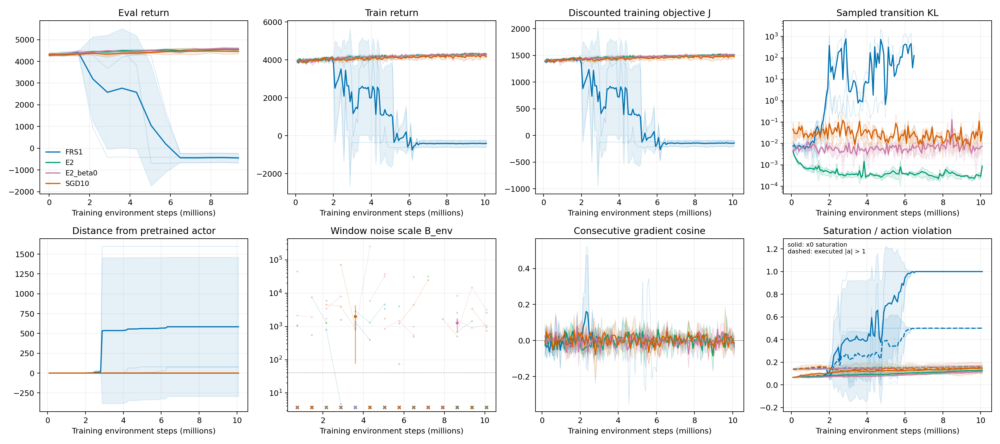

# Frozen-rescaling results

**Question.** Does frozen pretrained-gradient RMS rescaling improve E2 return or stability relative to E2_beta0?

**Answer.** All three FRS1 training runs and final-checkpoint evaluations completed. FRS1's last-10 discounted objective is lower by at least two pooled seed SD; this is a descriptive comparison. These three-seed comparisons do not establish equivalence to adaptive Adam or a convergence theorem.

| Metric | FRS1 mean ± SD | E2_beta0 mean ± SD | Difference / 2 pooled SD |
| --- | --- | --- | --- |
| eval_itr130 | -446.6 ± 220.8 | 4588 ± 42.19 | -5034 / 317.9 |
| train_last10 | -411.6 ± 181.6 | 4301 ± 18.13 | -4713 / 258.1 |
| J_disc_last10 | -143.5 ± 56.52 | 1511 ± 8.15 | -1655 / 80.76 |
| median_kl | 0.02678 ± 0.04638 | 0.005554 ± 0.0005588 | 0.02122 / 0.06559 |
| theta_dist_final | 584.1 ± 877.1 | 0.8562 ± 0.02777 | 583.2 / 1240 |

Thin seeds and mean ± sample SD use native results; [captions](captions.md) define all panels. In-training evaluation ends at itr130/9.36M steps, before the state139 checkpoint at10.08M. The [per-seed](seed_results.csv), [condition](condition_results.csv) and [comparison](comparisons.csv) tables include final-checkpoint returns/J under both samplers, delta-J, noise, collapse and timing. No survivor-only means are used.

**Ratio excursions.** seed0 KL max 1384 at itr87 (max/median ratio 3.852e+05/0); seed1 KL max 2181 at itr65 (max/median ratio 2.195e+04/0.02058); seed2 KL max 2317 at itr39 (max/median ratio 7.679e+06/0). The [ratio/KL figure](frs_ratios_kl.png) and [raw extrema](ratio_extrema.csv) show temporal coincidence without a new spike threshold or causal claim.

**Frozen scales.** Median r=0.0006267; exact zeros=47798; strictly floored coordinates=49850. The largest 5684 coordinates carry 0.7902 of total r². [All seven quantiles and definitions](rescale_statistics.csv) come from the passed cached-input gate.

**Setup and limits.** FRS1 uses fixed LR1e-4 and the unchanged E2 estimator, frozen float64 RMS of25 saved V4 full-batch gradients (source seed1000; processing seed4000), and denominator max(r,0.001×global median)+1e-8. Saved per-environment float32 gradients summed in float64 need not reproduce shuffled training accumulation bitwise. Gym initial states are not paired; the old theta0 evaluation has three repeats, while FRS final evaluations have one. Batch-coupled noise windows are approximate. Separately, the prior Phase1 signal-norm percentile CI limitation remains; r statistics are RMS heterogeneity, not signal CIs.

**Decision.** Review these candidates for keep, revise or leave uncurated. No extra runs, rescue changes or automatic curation are authorized.
